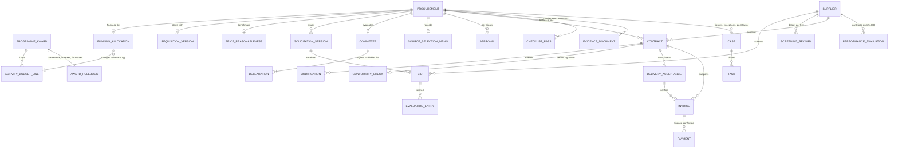
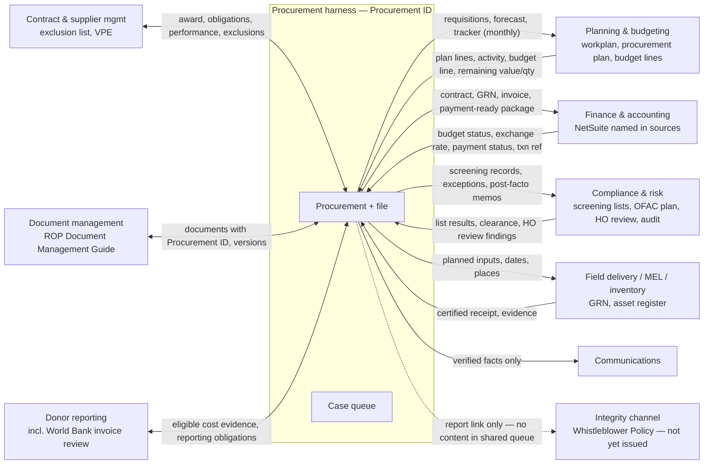
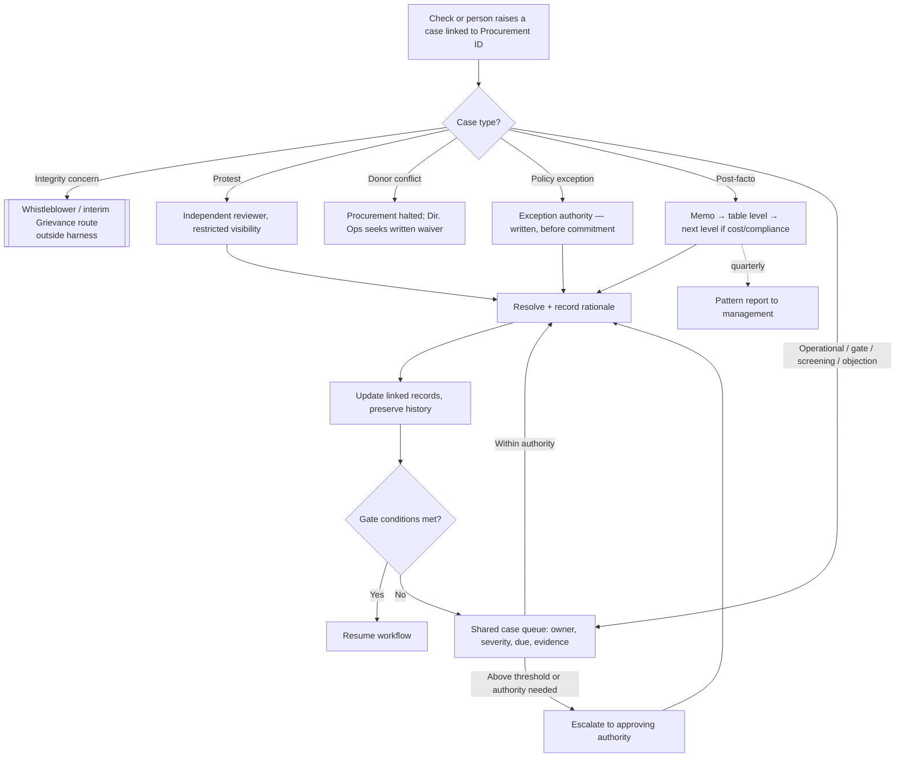

# ROP AI-Native Procurement Blueprint — Reconciled with Procurement Policy Draft 1.0

**Version:** Blueprint v0.3, 27 October 2026  
**Builds on:** *ROP AI-Native Procurement Workflow Map*, Draft 0.2 (27 Oct 2026), kept unchanged at [ROP-PROCUREMENT-WORKFLOW-MAP-DRAFT-0.2.md](ROP-PROCUREMENT-WORKFLOW-MAP-DRAFT-0.2.md). All of its content is carried forward here, corrected where the policy package showed it was wrong or too vague.  
**Reconciled against:** S01 Procurement Policy review package (28 Aug 2026): Remediation Brief (7 Aug), Start Here, **Procurement Policy Draft 1.0 (clean, the primary text)**, the redline with its review comments, and *Where Everything Went*. Item 4 of the package (Phase Zero Assessment Run 2) was not in the ZIP and was not used.  
**Status:** This is a planning brief and a target-state design. It is not policy and not an approved implementation plan. Nothing here has been built.

> **Name collision, please read.** The workflow map's "Draft 0.2" is a **workflow design** document dated 27 Oct 2026. The policy also had a "v0.2" (20 Aug 2026, trial). They are unrelated documents. In this blueprint, **WM** means the workflow map and **P** means Policy Draft 1.0.

---

## 0. How to read this blueprint

### Status tags

Each material control or statement carries one tag. A tag says where the statement comes from. It does not make the statement true.

| Tag | Meaning | Rule |
|---|---|---|
| **[CUR]** | **Described as current in a source.** Either a source says the instrument is in force, or the package describes the practice as something the field does today. | Repeats what the source says. It has **not** been independently verified against legal or organizational records. |
| **[D1 §x]** | **Draft policy proposal.** Stated in Procurement Policy Draft 1.0 at clause §x. | Draft 1.0 is **not approved and not in force** (P front matter; Start Here). Do not build it in as a hard requirement. Make it a configurable rule labelled with its rule-set version. |
| **[D1* §x]** | Draft 1.0 text that the drafter **explicitly calls a proposal awaiting confirmation** (for example the six-month re-screen and seven-year retention). | Weaker than [D1]. Treat it as a placeholder value. |
| **[TS]** | **Target-state workflow.** Proposed in WM Draft 0.2 or in this blueprint. | A design intent. It is neither policy nor current practice. |
| **[OPEN]** | **Open decision or missing input** in either source. | Must not be resolved by the workflow. It needs a named owner. |
| **[PA]** | **Prototype assumption.** Used only to demonstrate a flow. | Not policy. Lives only in the prototype configuration. |

### Source keys

| Key | Source |
|---|---|
| P §x | Procurement Policy Draft 1.0, 28 Aug 2026 (clean) |
| P PI-n | Draft 1.0 "Pending inputs" table, row n |
| P Ann. A–G | Draft 1.0 annexes |
| RL §x | Review comment in the redline anchored at §x (attributed by role, not by name) |
| RB | Governance Remediation Brief, Item 1, 7 Aug 2026 |
| SH | Start Here, 28 Aug 2026 |
| WEW | Where Everything Went (disposition record), with finding IDs such as A1 and B15 |
| WM §x | Workflow Map Draft 0.2, section x |

---

## 1. Policy status baseline: what is actually in force

The workflow has to say which rules it is running. The sources do not give a clean answer.

| Item | What the sources say | Tag |
|---|---|---|
| Instrument in force | "Until the CEO approves [Draft 1.0], the instrument in force is the ROP UN Procurement Policy (CBARD) of April 2025." | [CUR] per SH and P front matter |
| Scope of the in-force instrument | The April 2025 policy's methods apply "under United Nations funded programs" (its §3). It does not say which rules govern a World Bank-financed purchase. That gap is G1. | [CUR] per RB change 1 |
| October 2022 policy | It also carries a live "supersedes all previous policies" claim. It "stays filed as in force until Annex B is approved." | [CUR] per RB §5. **This conflicts with SH**, which names only the April 2025 policy as in force. |
| Thresholds USD 500 / 5,000 / 25,000 | Both predecessor policies already agree. Draft 1.0 deliberately keeps them. | [CUR] per RB §3 and WEW Part B; retained in [D1 §3.1] |
| Methods (micro to large, sole source, RFQ/RFP, LPTA/best value, BPA, framework) | Both predecessors agree, and no defect was recorded. They are kept. | [CUR] per RB §3; retained in [D1] |
| Approval roles in the current instruments | They route approvals to **six titles that no longer exist**: Executive Director, President, Director of Programs, Senior VP Programs, HO HR Manager, and head of the business unit. | [CUR] per RB change 3 and P Ann. G |
| Approval practice today | The Chief of Party signs the Source Selection Memo. The package goes to Home Office with the purchase order or agreement drafted. The CEO pre-approves the SSM/PO and the payment above USD 25,000. | [CUR] practice described in RL §4.9 and RL §2.6 |
| Reporting channel in the current instruments | Three defunct routings: a closed programme helpline, a personal staff address, and a Board member's private email. | [CUR] per RB change 4. These must not be reproduced anywhere in the workflow. |
| Finance system | NetSuite is named. ROP has a procedure for updating monthly exchange rates in NetSuite, and the Finance Manual "was built into NetSuite". | [CUR] per P §4.13 and RL §4.13. Whether the NetSuite configuration *is* the operative payment procedure is [OPEN] and belongs to the CFO. |
| Effective date of Draft 1.0 | Not set. The CEO sets it on approval. | [OPEN] P PI-10 |
| Automation dependency | "World Bank procurement readiness and the automation build sample sit behind" approval of this item. | [CUR] statement of dependency, RB §7 |

**Design consequences**

1. **Every procurement record carries `governing_policy`, fixed when the requisition is approved** [D1 transition clause]. Values: April 2025 (CBARD), October 2022, or Draft 1.0 once it is effective. Which value applies to a non-UN-funded purchase *today* is genuinely unresolved, and that is the G1 gap itself.
2. **Approvers cannot be hard-coded.** No current written instrument names roles that exist, and the Draft 1.0 bridge (Ann. G) is deliberately left blank. Approvals are modelled as *approval triggers* resolved to roles through a configurable authority table.
3. **Thresholds are the most stable element available.** Build on them, but still record their source.
4. **The remediation brief puts the "automation build sample" behind policy approval.** A prototype built before approval should be framed as a design and replay test on historical records, not as the automation build. Confirm this framing with the Director of Operations (§11).

---

## 2. End-to-end workflow

The eight WM lifecycle stages are kept. Draft 1.0 describes its own **nine-step** sequence (P §4 preamble). The map below places those steps inside the eight stages and makes the **hard gates** visible. It also adds a **Stage 0 (programme start-up)**. Stage 0 sits upstream of the lifecycle and is not a ninth stage, but every purchase depends on it (P §1.4).

```mermaid
flowchart TB
  subgraph S0["0 · Programme start-up — upstream, once per award"]
    S0A["Read award: framework 2 CFR 200 / FAR / funder rules<br/>applicable donor + country annex, forms set<br/>D1 §1.3b, §1.4"]
  end

  subgraph ST1["1 · Identify need"]
    P1["Procurement plan line / workplan activity<br/>D1 §2.7"] --> R1["Need confirmed by budget holder<br/>contractor vs subrecipient check D1 §1.3c"]
  end

  subgraph ST2["2 · Prepare requisition and package"]
    R2["Requisition: item, qty, spec, date, place, funding source,<br/>budget line, planned/urgent, E&S risk  D1 §4.1, §2.8"]
    R3["Price reasonableness attached  D1 §4.2<br/>Level set from estimated value  D1 §1.8, §3.1"]
    R4["Method + instrument + evaluation method  D1 §4.3<br/>Solicitation, pass/fail + scored criteria, bid plan  D1 §4.4, §5.4"]
  end

  subgraph ST3["3 · Review and authorize"]
    GA{"GATE A<br/>Requisition approved<br/>before any supplier approached<br/>D1 §3.2"}
    HOR{"Large: HO compliance review<br/>of solicitation before issue<br/>D1 §5.4"}
    GB{"GATE B<br/>Solicitation + evaluation plan<br/>+ bid plan approved<br/>D1 §3.2, §5.4"}
  end

  subgraph ST4["4 · Conduct procurement and select supplier"]
    C1["Issue + advertise 10/14 days; Q&A to all bidders<br/>D1 §4.5, §5.7"]
    C2["Bids held sealed outside procurement custody<br/>receipt time logged  D1 §4.6"]
    C3["Declarations vs named bidder list<br/>then opening record signed  D1 §4.6, §4.7"]
    C4["Pass/fail qualification, then scoring<br/>samples, low-bid test, clarifications  D1 §4.4, §4.7, §4.10"]
    C5["Screening + due diligence of intended awardee<br/>D1 §4.8"]
    C6["Source Selection Memo  D1 §4.9"]
  end

  subgraph ST5["5 · Award and manage contract"]
    GC{"GATE C<br/>Award approved<br/>Large: HO package review<br/>D1 §3.2, §5.4"}
    K1["Draft PO/contract with required clauses  D1 §4.11"]
    K2["Conformity check vs solicitation,<br/>winning bid, donor annex  D1 §4.11"]
    CP1{"GATE D<br/>Checklist pass 1<br/>corrections confirmed<br/>D1 §4.17"}
    K3["Sign = commitment<br/>contract manager named  D1 §1.8, §4.15"]
  end

  subgraph ST6["6 · Receive and verify"]
    D1N["Requester inspects, signs GRN/SRN<br/>alternate receipt place recorded on GRN<br/>D1 §4.12"]
    D2N["Assets tagged per Asset Mgmt Policy<br/>works: supervising officer certifies on site  D1 §4.15"]
  end

  subgraph ST7["7 · Verify invoice and pay"]
    F1["Invoice captured, matched to contract + GRN"]
    F2["Re-screen if >6 months  D1* §4.8<br/>payee verification  D1 §4.13<br/>tax/withholding per country annex  D1 §4.14"]
    CP2{"GATE E<br/>Checklist pass 2: complete file,<br/>certified receipt, screening<br/>D1 §4.13, §4.17"}
    F3["Payment approval + release<br/>per Finance Manual / NetSuite<br/>OPEN PI-11"]
  end

  subgraph ST8["8 · Close out and learn"]
    X1["Closeout checklist + vendor performance eval<br/>for contracts > 5,000  D1 §4.15"]
    X2["File complete, retained, audit sample<br/>D1 §4.17, §2.6"]
  end

  S0A -.governs.-> R2
  R1 --> R2 --> R3 --> GA --> R4 --> HOR --> GB --> C1 --> C2 --> C3 --> C4 --> C5 --> C6 --> GC
  GC --> K1 --> K2 --> CP1 --> K3 --> D1N --> D2N --> F1 --> F2 --> CP2 --> F3 --> X1 --> X2
  X2 -.performance + lessons.-> P1

  EXQ[["Shared case queue<br/>issues · policy exceptions · post-facto · objections"]]
  SAFE[["Integrity reports + protests<br/>separate confidential route  D1 §2.4, §7.1"]]
  GA -.-> EXQ
  GB -.-> EXQ
  C4 -.-> EXQ
  C5 -.-> EXQ
  GC -.-> EXQ
  CP1 -.-> EXQ
  D1N -.-> EXQ
  CP2 -.-> EXQ
  X1 -.-> EXQ
  C4 -.suspected collusion / bribery.-> SAFE
  C6 -.bidder protest.-> SAFE
```

### Which gates apply at which level

The diagram shows the Large path, which has the most controls. Lower levels use a subset of it.

| Step / document | Micro ≤500 | Small 501–5,000 | Medium 5,001–25,000 | Large >25,000 | Source |
|---|---|---|---|---|---|
| Approved requisition (Gate A) | ✓ | ✓ | ✓ | ✓ | [D1 §3.2, §3.4] |
| Price reasonableness evidence | ✓ | ✓ | ✓ | ✓ | [D1 §4.2] |
| Competition | 3-supplier market pricing record | 3 written quotations | Open RFQ/RFP, advertised ≥10 days | Open RFQ/RFP, advertised ≥14 days | [D1 §3.1, §4.5, §5.1–5.4]; thresholds [CUR] |
| Solicitation + evaluation plan approval (Gate B) | — | — | ✓ | ✓ plus bid plan and committee composition | [D1 §3.2, §5.4] |
| HO compliance review of solicitation (3 working days, named alternate) | — | — | — | ✓ | [D1 §5.4]; turnaround and alternate are [D1*] per RL §5.4 |
| Bid committee | — | — | Required for best value; may be waived in writing for LPTA | Always | [D1 §4.7] |
| Bid opening record and signed declarations | — | — | ✓ | ✓ | [D1 §3.4, §4.6, §4.7] |
| Screening of parties | ✓ | ✓ | ✓ | ✓ | [D1 §3.4, §4.8] |
| Due diligence (legal existence, capacity, no staff connection, not excluded) | — | — | ✓ | ✓ | [D1 §4.8] |
| Source Selection Memo | — | ✓ | ✓ | ✓ | [D1 §4.9] |
| HO review of complete package before award | — | — | — | ✓ | [D1 §5.4] |
| PO or contract (conformity check + checklist pass 1) | — | ✓ | ✓ | ✓ | [D1 §3.4, §4.11, §4.17] |
| Goods/services received note | ✓ | ✓ | ✓ | ✓ | [D1 §3.4, §4.12] |
| Payment approval + proof (checklist pass 2) | ✓ | ✓ | ✓ | ✓ | [D1 §3.4, §4.17]; approval ladder [OPEN PI-11] |
| Vendor performance evaluation + closeout checklist | — | — | Contracts >5,000 | ✓ | [D1 §3.4, §4.15]. **Not performed today; forms do not exist** [CUR per RL §4.15] |

Sole source (any value, approved before the procurement begins) [D1 §5.5]; limited competition [D1 §5.6]; blanket purchase agreements, release orders and frameworks [D1 §6]: these are **variants**. They change Stages 2–5 and should be modelled as alternative paths, not as extra stages.

---

## 3. Lifecycle stage cards

One card per stage. Each card can be copied onto butcher paper as a column. Rows tagged **[TS]** carry WM content forward. **[D1]** rows add policy detail.

### Stage 0 (upstream): Programme start-up

| Field | Content |
|---|---|
| Trigger | A new award or programme is set up. |
| People / actions | Director of Operations reads the award's instrument classification and obtains written clarification from the awarding agency if it is ambiguous [D1 §1.3b]. Identifies the governing donor and country annex and the forms/templates to use [D1 §1.4]. A "project charter" in the Program Standards could populate this [OPEN, RL §1.4; WEW C.3]. |
| Records | **Programme/Award** record: framework, applicable annex(es), forms set, period, budget lines with value and quantity where the funder budgets them [D1 §4.1]. |
| AI | Extract framework terms, budget lines and procurement clauses from the award document, and flag ambiguity [TS]. AI **does not classify the instrument** [D1 §1.3b]. |
| Automation | Create the award record and attach the rule-set and forms set to it [TS]. |
| Human authority | Director of Operations (classification clarification, donor conflicts under §1.4 rule 4) [D1]. |
| Output / handoff | The award "rulebook" that every Procurement ID under this award inherits. |
| Exceptions | Ambiguous classification. A donor requirement that cannot be satisfied alongside the policy, in which case **the procurement does not proceed** until a written waiver is obtained [D1 §1.4 rule 4]. A World Bank award with Annex C reserved, in which case the body applies in full [D1 Ann. C]. The ARLP instrument type is unknown [OPEN PI-9]. |

### Stage 1: Identify the need

| Field | Content |
|---|---|
| Trigger | A planned line in the annual procurement plan or workplan activity comes due, given lead time [D1 §2.7; TS]. Or an urgent or unplanned need is raised [D1 §4.1 planned/urgent flag]. |
| People / actions | Technical requester drafts the need. **Budget holder (the requesting department) owns and submits it** [D1 §2.1, §4.1]. Planning-stage checks: specification confirmed with technical staff, quantity tied to the activity, procurement/logistics costs budgeted, lead time compared with the implementation timetable. If the market cannot deliver in time, the *activity* is re-planned rather than the procurement shortened [D1 §2.7]. If funds will pass to a party, a contractor-vs-subrecipient determination is made **in writing before commitment** [D1 §1.3c]. |
| Records | Plan item (own ID) → **Procurement** draft (Procurement ID) linked to Award, Activity, Budget line and intended result [D1 §2.7; TS]. |
| AI | Extract planned needs from the workplan and plan, classify the category, flag duplicates and ambiguous specifications [TS, from WM]. Flag likely subrecipient characteristics for human determination [TS]. |
| Automation | Lead-time calculation and reminders from the plan [TS]. Procurement tracker entry with expected delivery date, reported at least monthly [D1 §2.7]. Cumulative-spend watch per supplier/category for splitting [D1 §3.3]. |
| Human authority | Budget holder confirms the need. **A purchase that cannot be tied to a workplan activity is not procured** [D1 §2.7]. |
| Output / handoff | A confirmed need goes to requisition preparation. |
| Exceptions | No activity or budget link. Unrealistic lead time. Possible split purchase. Party looks like a subrecipient, which routes to the Grant-Making Standard and out of this workflow [D1 §1.3c, §2.7]. |
| Not adopted | **Procurement initiated from the plan rather than by the budget holder** is *held* as a CEO decision because it changes ownership, and there is a cost-principle objection to pre-buying [OPEN, WEW Part E]. The workflow may **schedule and remind** from the plan (the "middle ground" in WEW Part E) but must not auto-submit requisitions or pre-buy. |

### Stage 2: Prepare the requisition and procurement package

| Field | Content |
|---|---|
| Trigger | Need confirmed. |
| People / actions | **Requisition** by the budget holder, stating item, quantity, specification, delivery date and place, expected price, planned/urgent, workplan activity and **funding source** [D1 §4.1, §1.3b]. **Budget verification against what remains on the budget line: value, and quantity where the funder budgets quantities.** Shortfall means a revision agreed **with the funder** before approval [D1 §4.1]. The requisition records the **budget line, not the category** [D1 §4.1]. E&S risk is recorded and specification controls are drawn from the EMMP/ESMP. Until that instrument exists, the Director of Operations approves the controls [D1 §2.8]. Specifications must not restrict competition [D1 §4.1]. **Price reasonableness** is established by procurement staff and attached *before* approval; works use a bill of quantities [D1 §4.2]. Level is set from estimated value (12 months, all-in, converted at the ROP monthly rate on the approval date) [D1 §1.8, §4.13]. After Gate A: instrument and evaluation method are chosen together (RFQ→LPTA, RFP→best value) [D1 §4.3]. Solicitation drafted with pass/fail qualification separate from scored criteria; a total score never substitutes for a minimum requirement; submission terms stated once; bid validity; protest route; related-bidder declaration; reporting channel; English text governs, with variable content outside translated blocks [D1 §4.4]. Large: bid plan including committee composition [D1 §5.4]. Sole source: written justification [D1 §5.5]. |
| Records | Requisition (versioned), price reasonableness evidence (with exchange rate and date), solicitation (versioned), evaluation plan/bid plan, E&S risk flag. |
| AI | Draft specifications or ToR from past records. Assemble the price-reasonableness pack from past purchases, BPA prices and catalogues, citing sources. **Pre-check solicitation internal consistency**: weights sum, annex numbers exist, thresholds stated the same way throughout, qualification criteria worded identically everywhere, and no pass/fail factor carried as points [TS; this mirrors what the HO review catches per RL §5.4]. Flag brand-name restrictions [TS]. |
| Automation | Populate forms from linked records. Remaining value/quantity check against the budget-line source. Level calculation. Template selection from the award's forms set. Missing-field blocking [TS]. |
| Human authority | Technical staff validate the specification. Procurement staff choose the method and record why [D1 §4.3]. Budget revision rests with the funder. |
| Output / handoff | Requisition goes to Gate A. The solicitation package goes to Gate B. |
| Exceptions | Insufficient remaining value or quantity. Weak or missing price basis, in which case the requisition is **returned as incomplete** [D1 §4.2]. Restrictive specification. Inconsistent solicitation. E&S instrument missing. |
| Open | **How far quantity control goes**: every purchase, or only above a threshold [OPEN, SH decision 3]. Whether supplier-installed equipment on a beneficiary plot is works; this blocks the RFQ template [OPEN C4, SH]. |

### Stage 3: Review and authorize

| Field | Content |
|---|---|
| Trigger | Requisition complete (Gate A). Solicitation package complete (Gate B). |
| People / actions | **Gate A**: requisition approval **before any supplier is approached**, at every level [D1 §3.2]. **Large only**: Home Office compliance review of the solicitation and annexes. This is distinct from approval. Proposed at 3 working days with a named alternate; the solicitation is not issued until cleared [D1 §5.4; D1* turnaround]. **Gate B**: approval of solicitation and evaluation plan (Medium/Large) and of bid plan and committee composition (Large) **before issue** [D1 §3.2, §5.4]. Sole source approval comes **before the procurement begins** [D1 §3.2, §5.5]. Any **objection** by a required signatory is filed as a memo; the decision stays with the approving authority [D1 §4.1]. |
| Records | Approval records (trigger, role from the authority table, decision, version approved, timestamp). HO review findings and clearance. Objection memos. Locked solicitation version with **criteria fixed** [D1 §4.4]. |
| AI | Draft an evidence-based approval summary that cites the record. List gaps and contradictions [TS, from WM]. |
| Automation | Route each trigger to the role resolved from the authority table or bridge. Reminders. **Block issue** until Gates A/B and HO clearance are recorded. Lock the approved version [TS]. |
| Human authority | Approving authority per the authority and approval table, **not yet approved**. Annex G bridge is blank [OPEN PI-2]. Policy exceptions are approved only by the exception authority, **in writing, before commitment** [D1 §1.7]. |
| Output / handoff | Authorized solicitation goes to launch. |
| Exceptions | Out-of-authority request. Missing approval. Package returned. HO review overdue. Approval sought after suppliers were already approached, which is a post-facto action [D1 §4.16]. |

### Stage 4: Conduct procurement and select supplier

| Field | Content |
|---|---|
| Trigger | Solicitation authorized. |
| People / actions | Advertise publicly: Medium ≥10 days, Large ≥14 days, ≤30 days from last publication; country media per annex [D1 §4.5]. All bidder communication goes through the named procurement officer. Q&A is issued to all bidders without naming the asker [D1 §5.7]. **Bid custody**: electronic bids go to a dedicated mailbox controlled by **two senior managers outside procurement**. Paper bids are logged with time and envelope condition and locked away. Nothing is opened before closing. Late bids are returned [D1 §4.6]. *Transitional*: two named independent recipients, one outside the country office [D1 §4.6]. Committee: ≥3 voting members (budget holder or representative, technical member, senior-management chair); procurement administers and does not vote [D1 §4.7]. **Declarations signed against the named bidder list before seeing any bid** [D1 §4.7]. **Signed bid opening record** with each bid's receipt date and time [D1 §4.6]. Pass/fail qualification first, then scoring [D1 §4.4]. Abnormally low bids (working guide 20–30% below benchmark) are investigated [D1 §4.7]. Samples and demonstrations are recorded with date, photos and signatures [D1 §4.7]. Clarifications are written and chair-authorised, with no bid changes. BAFO only for best value, with approval [D1 §4.10]. **Screening** of the intended awardee against donor-specific lists plus the OFAC Compliance Plan. **Due diligence** at Medium and above, with evidence collected with the bid [D1 §4.8]. SSM signed by the chair [D1 §4.9]. |
| Records | Advertisement proof, Q&A log, bid receipt log, bids (confidential), declarations, opening record, evaluation sheets, sample reports, clarification log, screening record (party, lists, date, result, reviewer), DD evidence, SSM with bid matrix. |
| AI | Draft solicitation text and the advertisement. **After the opening record is signed**: extract bid data, check document completeness against the stated qualification evidence, draft the comparison matrix for the committee, flag inconsistencies (unit price vs total, unit of measure), flag abnormally low bids against the benchmark, and draft the SSM narrative from the committee's recorded decisions [TS]. **AI must not touch bid contents before the closing time and opening** [D1 §4.6]. |
| Automation | Deadline tracking. Timestamped receipt log. Withhold bid access until closing. Require declarations before granting evaluators access. Route evaluation. Screening-due and re-screen dates [TS]. |
| Human authority | The committee decides pass/fail, scores and ranking. A person reviews every screening result, and potential matches are resolved with documented rationale [TS from WM; Draft 1.0 requires the result be recorded, D1 §4.8]. DD assessed by the committee before award [D1 §4.8]. |
| Output / handoff | SSM and recommended award go to Gate C. |
| Exceptions | No acceptable or too few bids, or all over benchmark: re-advertise once on the same terms, then re-examine the estimate and specification before a third attempt [D1 §7.2]. Conflict declared [D1 §2.3]. Potential screening match. Committee constituted other than as approved, which **does not evaluate** [D1 §4.7]. No senior manager available as chair: remote HO chair, else a named substitute appointed in writing [D1 §4.7]. Illiterate bidders: verbal bid recorded and read back [D1 §7.6]. **Suspected collusion or bribery goes to the confidential route, not the shared queue** [D1 §2.4]. |
| Open | One committee or two (opening vs technical evaluation). The two-committee split is current practice; the draft text describes one committee [OPEN C5; CUR practice per WEW B16]. **The dedicated bid mailbox is not current practice** [CUR per RL §4.6]. Draft 1.0 names it "the first automation of the procurement workflow" [D1 §4.6]. |

### Stage 5: Award and manage contract

| Field | Content |
|---|---|
| Trigger | SSM complete. |
| People / actions | **Gate C**: award approval per the authority table, after the SSM and before any commitment [D1 §3.2]. Large: the complete package is reviewed and approved at HO before award; incomplete packages are returned unreviewed [D1 §5.4]. Unsuccessful bidders are notified [D1 §4.10]. Contract form follows the requirement (PO, supply, works, lease, consultancy, service, or release order) [D1 §4.10]. Ten **required clause areas** apply [D1 §4.11]. **Conformity check before signature** against the solicitation, the winning bid and the applicable donor annex, recorded [D1 §4.11]. **Checklist pass 1**. Required corrections are confirmed in writing by the reviewer who required them. **No signature while a correction is outstanding** [D1 §4.17]. Liquidated damages at the standard 0.1%/day, capped at 10%; any other rate must be in the solicitation [D1 §7.7]. Bonds only where they protect a real interest [D1 §7.8]. Named contract manager [D1 §4.15]. Subcontracting needs written consent [D1 §4.15]. Works: supervising officer named before work begins [D1 §4.15]. Any change to price, scope, quantity or time is a **modification approved before it is performed** [D1 §4.10]. |
| Records | Award approval, notification letters, contract/PO (versioned, signed version immutable), conformity check record, checklist pass 1, clause set, milestones and obligations, modifications. |
| AI | Draft the contract from the template and award data. **Run a pre-conformity comparison** of contract vs solicitation vs winning bid vs annex covering funding source, donor clauses, scope, quantities, delivery point and period, payment terms, annex coherence and date consistency (for example damages falling due before delivery ends). Output is findings with citations for the human check [TS; targets WEW A1, A9]. Extract obligations and milestones [TS]. |
| Automation | Populate fields. Create milestone and obligation tasks. Block signature until conformity check and checklist pass 1 are recorded. Notify delivery, finance and field teams [TS]. |
| Human authority | Approving authority signs. A person performs and signs the conformity check. Contract terms that vary the standard terms need exception approval [D1 §4.11]. |
| Output / handoff | Executed contract or PO (the **commitment**, D1 §1.8) goes to delivery, finance and field. |
| Exceptions | Wrong donor regime or clauses (WEW A1). Missing clauses (A2). Damages above the standard (A9). Unsigned contract. Modification needed. Performance issue. Termination grounds [D1 §7.3]. Unapproved change, which is post-facto [D1 §4.16]. |

### Stage 6: Receive and verify goods or services

| Field | Content |
|---|---|
| Trigger | Delivery or service milestone due or reported complete. |
| People / actions | **The requester, not procurement, performs the physical check** against contract, delivery note and invoice, and signs the GRN/SRN. Discrepancies go to procurement before payment. Certification is "a substantive check and not a signature" [D1 §4.12]. Receipt at another place: reason, place, final destination and verifying person are recorded **on the GRN itself** [D1 §4.12]. Retained assets are tagged into the asset register on acceptance under the Asset Management Policy [D1 §4.12]. Imported goods: delivery term, title/risk and customs stated. Pre-shipment inspection above **[threshold]** [OPEN PI-8]. Non-conformity notice within 15 days [D1 §4.12]. Works: progress certificates signed by a supervising officer who is **physically present**, with dated photographs [D1 §4.15]. Beneficiary signatures or receipts, where required, belong to distribution/MEL and are not set by procurement policy [TS from WM]. |
| Records | GRN/SRN (with requesting-department field so signer and requester can be compared, WEW A20), inspection evidence, discrepancy notices, asset-register link, progress certificates. |
| AI | Extract delivery notes. Compare delivered vs contracted quantity, spec and place. Flag a GRN signer who is not from the requesting department. Flag photo evidence missing where required [TS]. |
| Automation | Reminders. Discrepancy routing. 15-day notice clock. Delivery status into the tracker [TS]. |
| Human authority | Requester certifies. Supervising officer certifies works. Procurement handles supplier remedy. |
| Output / handoff | Certified receipt goes to invoice matching and to field/MEL/inventory. |
| Exceptions | Short or damaged delivery, wrong place, missing evidence, remote certification of works (not permitted) [D1 §4.15]. |
| Open | Offline capture and sync [OPEN, WM]. Prepositioned stock in warehouses is **held**; it would change receipt and asset coverage [OPEN, WEW Part E]. **New works-supervision work "is not performed today"** and may need a later effective date [CUR per RL §4.15; OPEN]. |

### Stage 7: Verify invoice and make payment

| Field | Content |
|---|---|
| Trigger | Invoice or payment claim received. |
| People / actions | The invoice is issued by the supplier and states supplier, date, amount, item and quantity. Pro-forma invoices support payment; a tax invoice or receipt evidences it. Self-prepared vouchers are allowed for micro purchases only, where a country annex allows [D1 §4.13]. Instalments: full documentation is filed once, and later payments reference it (the asterisk convention, CUR practice per WEW B14) [D1 §4.13]. **Re-screen if the last screening is more than 6 months old** [D1* §4.8; who re-screens and when in the payment run is OPEN, RL §4.8]. **Payee verification**: account checked against contract and the supplier's banking evidence; a changed account needs confirmation through a different channel [D1 §4.13; CUR practice per WEW B19]. Advance payments only where unavoidable, approved before commitment, bonded above **[threshold]** [OPEN PI-8], and reconciled before further payment [D1 §4.13]. Tax withholding per country annex (Afghanistan 2%/7%, licence rules) [D1 §4.14, Ann. D]. Non-English invoices are filed with a translation (Annex D) [D1; CUR practice per WEW B20]. Two exchange rates (procurement level vs charge to funder) are visible in the payment record [D1 §4.13]. **Checklist pass 2** [D1 §4.17]. **Procurement confirms receipt; it does not approve payment** [D1 §3.2]. |
| Records | Invoice, match result, re-screen record, payee verification record, tax/withholding receipt, checklist pass 2, payment approval and proof (from finance), exchange rates used. |
| AI | Extract invoice data and translate. Explain mismatches (price, quantity, instalment, remaining value). Draft the payment-ready summary with links to every supporting record [TS]. |
| Automation | Three-way match (contract–GRN–invoice). Duplicate detection. Re-screen-due flag. Block "payment-ready" status until GRN, screening and checklist pass 2 are recorded. Receive the transaction reference and status back from finance [TS]. |
| Human authority | Finance verifies and approves payment per the Finance Manual. Payment approval levels are **not in procurement policy** [D1 §4.13]. |
| Output / handoff | Reconciled payment linked to procurement, contract, GRN and evidence. |
| Exceptions | Mismatch, duplicate, unsupported charge, bank-account change, stale screening, licence expired (Annex D withholding), unreconciled advance, delayed payment. |
| Open | **Finance Manual (2020) not reconciled; the payment approval chain must be visible on one document** [OPEN PI-11]. **Is NetSuite configuration the operative procedure?** (CFO) [OPEN, SH decision 4]. "The break between procurement and finance is a documentation problem", carried as a **platform design question** [OPEN, WEW C.2]. Month-end close as the system's real deadline [OPEN, WEW C.2]. |

### Stage 8: Close out and learn

| Field | Content |
|---|---|
| Trigger | All obligations complete, or an authorized closeout or termination decision. |
| People / actions | Contracts >5,000: **contract closeout checklist** and **vendor performance evaluation**, with scores used in future sourcing [D1 §4.15]. Works: final acceptance, defects period, VPE [D1 §4.15]. Finance verifies final payment, tax and completeness [D1 §4.15]. One electronic file, documents in production order, checklist first [D1 §4.17]. Retention for the longest of: 7 years from final payment [D1*], the donor period, or local law; federal awards 3 years from the final expenditure report [D1 §4.17]. Post-facto actions reviewed quarterly and patterns reported [D1 §4.16]. HO internal audit samples files without notice, independent of approvers [D1 §2.6]. Supplier exclusion (≤3 years, after the supplier is heard) [D1 §7.9]. |
| Records | Closeout checklist, VPE, final reconciliation, retention date, audit sample results, exclusion list entries. |
| AI | Find missing documents against the level's required set. Draft the closeout summary. Analyse cost, time and performance. Surface patterns across post-facto memos and exceptions [TS]. |
| Automation | Assemble the file index. Compute the retention date. Update the tracker. Feed performance to the supplier record. Notify connected teams [TS]. |
| Human authority | Contract manager and procurement confirm. Closeout approval [OPEN, WM]. Exclusion decided by the authority in the table [D1 §7.9]. |
| Output / handoff | Complete traceable record. Supplier performance into sourcing. Lessons into plans. |
| Exceptions | Outstanding obligations, claims or warranties, unreconciled balances, missing records. |
| Status note | **"Neither form exists and neither step is performed today, in any country office"** (closeout checklist and VPE) [CUR per RL §4.15]. WM's "record supplier performance" is **new work**, not a digitization of existing practice. |

---

## 4. Hard gates: the control spine

These are the points where the workflow **blocks progression**. The rules are Draft 1.0 proposals unless tagged otherwise, so in a prototype each one is a configurable rule labelled with its rule-set version.

| # | Gate | Blocks | Conditions | Source |
|---|---|---|---|---|
| A | Requisition approved | Approaching any supplier | Budget-line value (and quantity) remaining; price reasonableness attached; funding source; activity link; E&S flag | [D1 §3.2, §4.1, §4.2] |
| B | Solicitation authorized | Issue/advertising | Solicitation and evaluation plan approved; Large: bid plan approved and HO compliance clearance; criteria locked | [D1 §3.2, §4.4, §5.4] |
| B′ | Bid access | Opening and evaluation | Closing time passed; declarations against named bidder list signed; committee as approved | [D1 §4.6, §4.7] |
| C | Award approved | Any commitment | SSM signed; screening recorded; DD (Medium+); Large: HO package approval | [D1 §3.2, §4.8, §5.4] |
| D | Signature | Commitment | Conformity check recorded; checklist pass 1; required corrections confirmed in writing | [D1 §4.11, §4.17] |
| M | Modification | Changed work | Modification approved before performance | [D1 §3.2, §4.10] |
| E | Payment-ready | Payment release | Certified GRN; complete file; screening current (≤6 months, D1*); payee verified; checklist pass 2 | [D1 §4.12, §4.13, §4.17] |
| X | Policy exception | Any commitment relying on it | Written approval by exception authority **before** commitment; never retrospective | [D1 §1.7] |

The **checklist completed twice** (before signature and before payment) is described as what the field already does [CUR per WEW B13]. The design treats Gates D and E as the two points where a procurement "can still be stopped" [D1 §4.17].

---

## 5. Shared records and data architecture

### Procurement ID

| Rule | Source / status |
|---|---|
| One reference identifies the procurement from requisition to final payment. **Every document in the file carries it.** | [D1 §4.17]. This matches WM's Procurement ID anchor [TS]. |
| Assigned when the requisition draft is created. Plan items keep their own ID and link forward. | [PA]. WM assigned the ID at "draft need". The draft says "from requisition". Exact point is [OPEN]. |
| Format, and whether it reuses an existing reference (for example the POA numbering seen in "POA-ACRP-2026-010"), is undecided. | [OPEN] |
| Release orders under a BPA carry their own ID linked to the parent BPA procurement. | [PA]; BPA rules [D1 §6.2] |

### Data model (reconciled)

WM's nine core records are kept. Changes made because of the policy:

- **Funding allocation**: a purchase can be financed by several awards, with the split recorded [D1 §1.3b].
- **Programme/Award rulebook**: framework, annex and forms set [D1 §1.4].
- **Bids are separate from suppliers.**
- **Screening** is a dated, party-level record so the 6-month re-screen can work.
- **Approvals** and **checklist passes** are first-class records.
- **Cases** are typed (§8).
- Procurement-to-contract is **0..many**, to cover BPA, framework, multi-lot and modifications.

| Core record | Key fields added by Draft 1.0 | Authoritative source | Status |
|---|---|---|---|
| Programme / award | Framework (2 CFR 200 / FAR / funder), applicable annexes, forms set, clarification letters | Award document | [D1 §1.3b, §1.4]; source system [OPEN] |
| Activity / budget line | **Remaining value; remaining quantity and unit cost where the funder budgets them** (WB monitors unit cost, quantity and total) | Finance (NetSuite?) | [D1 §4.1; WEW C.2]; source [OPEN] |
| Procurement | Procurement ID, level, estimated value + rate + rate date, method/instrument, planned/urgent, E&S risk, **governing_policy**, status | Workflow | [D1 §1.8, §4.1, §4.13, transition] |
| Supplier / party | Legal existence, registrations, beneficial owners above [threshold], staff-relationship declaration, exclusion status, bank account evidence | Workflow + country evidence | [D1 §4.8, §4.13]; BO threshold [OPEN PI-8] |
| Screening record | Party, lists checked (by annex + OFAC plan), date, result, reviewer, rationale | Workflow | [D1 §4.8]; human review of every result [TS] |
| Contract | Executed terms, clause set, LD rate, bond, contract manager, supervising officer, modifications | Workflow / document store | [D1 §4.10, §4.11, §4.15] |
| Delivery / acceptance | Requester-signed GRN, requesting dept, alternate receipt place, asset tags, progress certificates | Workflow / field | [D1 §4.12, §4.15] |
| Invoice / payment | Invoice data, match result, payee verification, both exchange rates, tax receipt, finance transaction ref | Finance | [D1 §4.13, §4.14]; integration [OPEN PI-11] |
| Evidence / documents | Procurement ID on every document, production order, version, retention date | Document store per ROP Document Management Guide | [D1 §4.17] |
| Cases / tasks / decisions | Type, owner, severity, due, evidence, decision, rationale, visibility class | Workflow | [TS]; typing per §8 |

**Change behaviour** [TS, from WM, kept]: one authoritative source per fact. Links instead of copies. Prior values are preserved with source, actor and time. A forecast change never silently alters signed terms; contract changes go through **Modification** [D1 §4.10]. Superseded records are archived, not deleted [D1 §4.17].

**Confidentiality** [D1 §2.5, §4.6]: bids, evaluation records and supplier pricing are visible only to those with a need to know, and to nobody before closing. Dashboards and AI pipelines inherit these permissions.

---

## 6. Cross-workflow data flows

All connections are **proposed target-state integrations [TS]**. The status column records what the sources say exists.

| Connected workflow | Procurement sends | Procurement receives | What exists per sources | Status |
|---|---|---|---|---|
| Planning & budgeting | Need, requisition, forecast, tracker | Approved plan lines, budget line remaining value/qty, revisions | Annual plan and tracker required by [D1 §2.7]; budget-line ID already a requisition field (CBARD practice) [CUR per WEW C.2]. Plan-initiated procurement held [OPEN]. BOM-driven budgets held [OPEN]. | [TS] |
| Finance & accounting | Contract, GRN, invoice, payment-ready package | Budget status, monthly exchange rate, payment approval, txn ref | NetSuite with exchange-rate procedure [CUR, P §4.13]. Manual-vs-config question [OPEN]. Approval ladder [OPEN PI-11]. | [TS] |
| Compliance & risk | Screening records, exceptions, post-facto memos, audit samples | List results, clearance, HO findings | OFAC plan (Mar 2023) cited, currency unassessed [OPEN PI-6]. Donor lists per annex (1267 for UNDP, SAM.gov for USG) [D1 Ann. A/B]. | [TS] |
| Contract & supplier mgmt | Award, obligations, milestones | Amendments, performance, exclusions | Supplier exclusion list maintained by procurement [D1 §7.9]; existence today [OPEN]. VPE not performed today [CUR per RL]. | [TS] |
| Field delivery / MEL / inventory | Planned inputs, dates, places | Certified receipt, photos, asset tags | Asset Management Policy cross-referenced [CUR per RB §3]. Prepositioned stock held [OPEN]. | [TS] |
| Document management | Documents tagged with Procurement ID | Storage references, retrieval | ROP Document Management Guide cited [D1 §4.17]. Retention policy not yet drafted [OPEN PI-7]. | [TS] |
| Communications | Verified facts | Approved outputs | Not addressed by the policy. | [TS] |
| Donor reporting | Eligible-cost evidence linked to budget lines | Requirements, submission status | World Bank "reviews every invoice", so monthly packages must be audit-ready by design [CUR statement, SH]. Annex C reserved [OPEN PI-4]. | [TS] |
| Grant-making (boundary) | Subrecipient determinations route out | — | Grant-Making Standard (item 18) not yet issued [D1 §1.3c, §2.7]. | [TS] boundary only |
| Integrity channel (boundary) | Pointer that a report exists, if anything | — | Whistleblower Policy not drafted. Interim route is the Grievance Redressal Procedures [D1 §2.4; PI-1]. Channel must sit outside the org tenant's administrators [RL §2.4, design constraint]. | [OPEN] |

---

## 7. Roles, dashboards and task movement

Dashboards are views over the same records [TS]. Draft 1.0 adds roles WM did not name. **Segregation of duties is a condition of every procurement**: nobody authorizes or processes a procurement for themselves [D1 §2.1].

| Role | Default view | Key actions | Source |
|---|---|---|---|
| Technical requester | Needs to specify, deliveries to inspect | Drafts need/spec; **physically inspects and signs GRN** | [D1 §4.1, §4.12] |
| **Budget holder** (requesting department) | Requisitions to submit, remaining budget, objections | Owns and submits the requisition; verifies remaining value/qty; often contract manager | [D1 §1.8, §4.1, §4.15] |
| Procurement staff / officer | Packages, solicitations, bids due, committee admin, file gaps, tracker | Price reasonableness, method, solicitation, Q&A, committee admin (non-voting), SSM drafting, contract prep, file | [D1 §2.1, §4.2–4.10] |
| Bid custodians (2 senior managers outside procurement) | Bids held, closing times | Release bids only at opening | [D1 §4.6] |
| Bid committee (chair + ≥2) | Assigned evaluations, declarations | Declare, evaluate, sign opening record and SSM | [D1 §4.7, §4.9] |
| HO compliance reviewer (+ named alternate) | Solicitations awaiting review (3-day clock); Large packages pre-award | Clear or return; confirm corrections in writing | [D1 §5.4, §4.17] |
| Approving authority (per table) | Approvals due by trigger | Approve, reject, return; exception and post-facto decisions | [D1 §3.2]; roles [OPEN PI-2] |
| Contract manager | Milestones, obligations, performance | Track delivery; VPE | [D1 §4.15] |
| Supervising officer (works) | Sites, certificates due | On-site certification | [D1 §4.15] |
| Finance | Payment-ready queue, mismatches, re-screens, withholding | Verify and approve payment; return txn ref | [D1 §2.1, §4.13]; ladder [OPEN PI-11] |
| Director of Operations | Framework clarifications, donor conflicts, interim E&S approvals, post-facto patterns | Policy owner | [D1 §1.3b, §1.4, §2.8] |
| Internal audit (HO, independent of approvers) | Unannounced sample | Audit; report to the authority in the table | [D1 §2.6]; auditor appointment debated [RL §2.6] |
| Management | At-risk dates, overdue decisions, material cases | Resolve/assign above thresholds | [TS]; thresholds [OPEN] |

Reminder and escalation logic [TS, from WM]: follows dependencies, escalates only at agreed thresholds, and stops on completion. Channels and thresholds are [OPEN]. The **HO 3-working-day review clock** and the **15-day non-conformity notice** are the two explicit timers in Draft 1.0.

---

## 8. Exceptions: one queue, typed cases, one confidential route

WM proposed **one exception queue** [TS]. The policy separates several things that WM's "exception" merged together, and they route differently. The queue stays single, but every case carries a **type** and a **visibility class**. Two types must **never** enter the shared queue.

| Case type | Example | Route and authority | Visibility | Source |
|---|---|---|---|---|
| **Operational issue** | Short delivery, invoice mismatch, overdue task, no responsive bids | Owner resolves; escalate above threshold | Role dashboards | [TS] |
| **Control failure / gate block** | Missing price basis, HO review findings, missing declarations | Return to preparer; blocks the gate | Role dashboards | [D1 §4.2, §5.4] |
| **Policy exception request** | Non-standard LD rate, variation of standard terms | Exception authority, **in writing, before commitment** | Approvers | [D1 §1.7, §4.11, §7.7] |
| **Post-facto action** | Commitment before approval, unapproved scope change | Memo (what, why, cost, prevention). Reviewed at table level; **next level up if cost or compliance is affected**. Quarterly pattern review. | Approvers + procurement | [D1 §4.16] |
| **Objection memo** | Signatory thinks the procurement should be delayed or cancelled | Filed. Decision stays with the approving authority. **Objection stays on file.** | Approvers | [D1 §4.1] |
| **Donor conflict** | Donor rule and policy cannot both be satisfied | **Stop**. Director of Operations obtains a written waiver before commitment. | Dir. Ops | [D1 §1.4 rule 4] |
| **Screening match** | Potential or ambiguous list match | Human resolution with rationale | Restricted | [D1 §4.8; TS] |
| **Supplier protest** | Bidder alleges unfair treatment | **Nobody involved in the procurement reviews it.** Senior official or committee gives a written final position. | **Restricted. Excluded from the involved team's view.** | [D1 §7.1] |
| **Integrity concern** | Suspected fraud, bribery, collusion | **§2.4 channel only.** Not in the shared queue. Not visible to tenant administrators who could be the subject. | **Outside the harness** | [D1 §2.4; RL §2.4] |

Other gaps the policy leaves: **there is no emergency procurement route**. A genuine security emergency would land in post-facto, "the one section the policy treats as a failure" [OPEN, R4 not adopted, RL §4.16]. The case model should be able to represent an emergency route if one is adopted later.

---

## 9. AI, automation and human decision boundaries

| Layer | Appropriate in target state | Hard boundaries from policy |
|---|---|---|
| **Conventional automation** | Level calculation from estimated value and rate; remaining budget/qty check; splitting detection over 12 months; approval routing per authority table; gate blocking; timers (closing, 3-day HO review, 15-day notice, 6-month re-screen); timestamped bid receipt; checklist generation by level; three-way match; file index with Procurement ID; retention dates; tracker reporting [TS] | Rules are Draft 1.0 proposals or [OPEN], so every rule is **versioned and labelled with its source**. **No inferred policy** where values are bracketed (PI-8 thresholds) or roles are blank (Ann. G). **Bids stay sealed until closing**; automation enforces custody instead of reading bids [D1 §4.6]. |
| **AI** | Extract and classify award terms, requisitions, bids (after opening), invoices and delivery notes. Draft specifications, solicitations, contracts, SSM narratives and closeout summaries. **Pre-check solicitation consistency** and **pre-run the contract conformity comparison** with citations. Flag abnormally low bids, GRN signer mismatches, missing evidence and post-facto patterns. Translate invoices for filing. [TS] | AI **does not**: classify the award instrument [D1 §1.3b]; decide contractor vs subrecipient [D1 §1.3c]; decide pass/fail, scores or ranking [D1 §4.4, §4.7]; resolve screening matches [D1 §4.8; TS]; approve anything or record a "check" on behalf of a person; decide LD application, which "is a decision" [D1 §7.7]; decide exclusion [D1 §7.9]; ingest integrity reports or protests [D1 §2.4, §7.1]. AI output is visibly distinct from verified facts and cites its source [TS]. Bid content is processed only under §2.5 confidentiality and access controls. |
| **People** | Need confirmation, requisition submission, approvals at each trigger, HO review clearance, committee evaluation, screening review, award, conformity check, signature, receipt certification, works certification, payment approval/release, closeout, exclusion, exceptions, post-facto decisions [D1; TS] | Segregation of duties [D1 §2.1]. Approval roles come from the authority table [OPEN PI-2]. Payment approval comes from the Finance Manual [OPEN PI-11]. |

An important design point from the package: Draft 1.0 makes HO compliance review and the contract conformity check **named human controls** because they "actually catch the errors" (RL §5.4; WEW A1). The best uses of AI here are **preparing those two checks**: running them first, citing differences, and cutting reviewer time. AI should not replace them. The 3-working-day turnaround is a proposal [D1*], and AI pre-checks are what make it achievable.

---

## 10. Policy ↔ workflow reconciliation

### 10a. Where Draft 1.0 adds detail to a lifecycle stage

| Stage | Material additions (all [D1] unless marked) |
|---|---|
| 0 (new) | Framework read from the award, not decided by ROP (§1.3b). Annex and forms set fixed at programme start-up (§1.4). Precedence rules, including **stop on irreconcilable conflict** (§1.4). |
| 1 | Budget holder owns the requisition (§4.1). Every purchase is tied to a workplan activity and result (§2.7). Annual plan and monthly tracker (§2.7). Lead-time mismatch means re-planning the activity (§2.7). Contractor/subrecipient determination (§1.3c). |
| 2 | Funding source and **budget line (not category)** on the requisition. **Remaining value and quantity** verified. Planned/urgent and E&S flags (§4.1, §2.8). Price reasonableness is part of the requisition (§4.2). Estimated value definition and FX date (§1.8, §4.13). RFQ↔LPTA / RFP↔best value pairing (§4.3). Pass/fail vs scored criteria; submission, validity and language rules (§4.4). |
| 3 | Distinct approval triggers (§3.2). HO compliance review for Large (§5.4). Objection memo (§4.1). Exceptions only before commitment (§1.7). |
| 4 | Bid custody and transitional two-recipient rule (§4.6). Timestamped opening record (§4.6). Committee composition and chair fallback (§4.7). Declarations against named bidders (§4.7). Low-bid test, samples (§4.7). Clarification/BAFO limits (§4.10). Screening by donor list plus OFAC plan, 6-month re-screen (§4.8). DD with bid evidence (§4.8). Failed-solicitation ladder (§7.2). Illiterate bidders (§7.6). |
| 5 | Contract form by requirement (§4.10). Ten required clauses (§4.11). **Conformity check before signature** (§4.11). Checklist pass 1 and correction confirmation (§4.17). LD standard (§7.7). Bonds (§7.8). Contract manager, subcontract consent, supervising officer (§4.15). Modification before performance (§4.10). |
| 6 | Requester (not procurement) inspects (§4.12). Alternate receipt place on the GRN (§4.12). Asset tagging (§4.12). Imports and 15-day notice (§4.12). Works certified on site with dated photos (§4.15). |
| 7 | No payment without complete file, certified receipt and screening (§4.13). Payee verification (§4.13). Advance rules (§4.13). Two-rate visibility (§4.13). Withholding by country annex (§4.14). Checklist pass 2 (§4.17). Procurement does not approve payment (§3.2). |
| 8 | Closeout checklist + VPE for >5,000 (§4.15). File rules and retention (§4.17). Post-facto quarterly review (§4.16). Independent internal audit (§2.6). Exclusion (§7.9). |

### 10b. WM statements that conflict with Draft 1.0 or are too vague

| WM statement | Issue | Reconciled in this blueprint |
|---|---|---|
| Stage 1: "Approved workplan… indicates a purchase"; automation "create record" from planned needs | Edges into **plan-initiated procurement**, which the package *holds* for a CEO decision on cost-principle grounds (WEW Part E) | The plan **schedules and reminds**; the budget holder submits. No auto-requisition, no pre-buying. |
| Stage 1: "Technical requester confirms… need" | Draft 1.0 makes the **budget holder** accountable; the requester may only prepare | Budget holder added as owner (§7). |
| Stage 2: "screening/diversification requirements"; §10 "diversification/concentration controls" | No diversification control in Draft 1.0 except spreading micro purchases fairly (§5.1) and splitting rules (§3.3) | Re-scoped to splitting detection and micro spread. Wider diversification marked [OPEN]. |
| Stage 2: "Authorized personnel decide budget revisions" | Draft 1.0: the revision is **agreed with the funder** before requisition approval | Corrected. |
| Stage 2→3: one package, one authorization | Draft 1.0 has **separate gates**: requisition approval *before any supplier is approached*, then solicitation/evaluation plan approval, plus HO review for Large | Split into Gates A/B (§4). |
| Stage 4: "screen eligibility/sanctions" with no list basis | Lists are **donor-specific per annex** plus the OFAC plan; re-screen before payment | Screening record per list with date (§5). |
| §6 / §3: "Every supplier-screening result is reviewed by a person… This is explicit in Draft 0.2" | Explicit in the **workflow map**, not in the policy. Draft 1.0 requires screening and a recorded result. | Kept as a **[TS] control**. Proposed for confirmation as a policy or procedure rule. |
| Stage 4: no bid custody, declarations or opening record | Major omissions relative to §4.6–4.7, and these are where Draft 1.0 records field practice | Added (Gate B′). |
| Stage 5: "withholding requirements" recorded at contract | Withholding is applied at payment per country annex (§4.14, Ann. D) | Moved to Stage 7. Contract records the tax status. |
| Stage 5: no pre-signature check | §4.11 conformity check is the control that would have caught WEW A1 | Added as Gate D. |
| Stage 6: "beneficiary signatures where required" | Not a procurement-policy requirement. Belongs to distribution/MEL. | Labelled [TS], MEL boundary. |
| Stage 7: "authorize payment and release funds through established controls" | The established controls are the Finance Manual (2020, unreconciled) and possibly NetSuite config | Marked [OPEN PI-11]. Procurement stops at payment-ready. |
| Stage 8: "record supplier performance" as routine | Closeout checklist and VPE **are not performed today** | Marked as new work (CUR per RL). |
| §3 ER: `PROCUREMENT ||--o| CONTRACT`; single award parent | BPA/frameworks/modifications need 0..many. Multi-award funding needs a split record (§1.3b). | ER revised (§5). |
| §5 "Management" escalation "above agreed thresholds" | No approved authority table. Ann. G is blank. | Approval triggers resolved via configurable table (§1). |
| §7: single undifferentiated exception queue | Policy exceptions, post-facto, protests and integrity reports have distinct routes, and two must stay outside shared visibility | Typed cases (§8). |
| §9: "Proposed first build slice" | Did not account for the policy's payment gate, the replay-test obligation, or that the automation build is gated behind approval | Re-assessed (§11). |

### 10c. Unresolved decisions and missing inputs (from the package)

| ID | Item | Owner (per source) | Affects |
|---|---|---|---|
| C4 | Is supplier-installed equipment on a beneficiary plot **works**? Threshold for full supervision. | CEO/Dir. Ops (SH) | Stage 5–6 path, RFQ template |
| C5 | One bid committee or two (opening vs technical) | SH open decision | Committee data model, declarations, Stage 4 |
| Qty | Quantity control on every purchase or above a threshold | SH open decision | Budget-line model, Gate A |
| Fin | Finance Manual rewrite vs NetSuite config as operative procedure | CFO | Stage 7 integration |
| PI-1 | Whistleblower Policy and channel | Item 2 | Solicitation text, integrity route |
| PI-2 | Org structure v1.3 / authority table; Ann. G blank | CEO | All approvals |
| PI-3 | Reconciled Large checklist (three versions in circulation) | Dir. Ops | Gates D/E checklist content |
| PI-4 / PI-9 | World Bank (ARLP) terms; ROP's instrument type for ARLP | — | Stage 0 for WB awards |
| PI-5 | Guatemala rules (Annex E) | Country Director Guatemala | Country rules |
| PI-6 | OFAC plan currency | — | Screening |
| PI-7 | Retention period (7 years proposed) | CFO / item 11 | Retention dates |
| PI-8 | Thresholds: beneficial ownership, advance security, pre-shipment inspection | Dir. Ops + CEO | Gates C/E, Stage 6 |
| PI-10 | Effective date | CEO | `governing_policy` switch |
| PI-11 | Finance Manual reconciliation; one-document payment chain | CFO | Stage 7 |
| — | 6-month re-screen; who re-screens, where in payment run | CFO / country finance (RL §4.8) | Gate E |
| — | 3-day HO review turnaround; DD verification practice is real? | CFO (RL) | Gate B, Stage 4 |
| — | Held: plan-initiated procurement; BOM budgets; prepositioned stock; procurement–finance documentation break | CEO / platform | Stage 1, 6, 7 |
| — | No emergency procurement route (R4 not adopted) | Revisit before ARLP mobilisation (RL) | Case model |
| — | Department of State content in Annex B unconfirmed | — | Stage 0 for USG awards |
| — | Later effective date for new works-supervision / closeout work? | RL suggestion | Stage 6, 8 |
| — | Project charter in Program Standards as annex populator | Program Standards owner | Stage 0 |

### 10d. Conflicts between Draft 1.0 and current status

1. **Which policy governs today is itself contested.** SH names April 2025 (CBARD) as in force. RB says the October 2022 policy stays filed as in force until Annex B is approved. April 2025's scope is UN-funded programmes. *Implication:* the prototype records `governing_policy` and must not claim compliance with "the" current policy.
2. **Approval roles.** Current instruments name defunct titles. Current practice (COP signs SSM, HO approval with POA drafted, CEO pre-approval above USD 25,000) is not written policy. Draft 1.0 cites a table that is not approved. *Implication:* there is no confirmed approval chain to encode.
3. **Controls Draft 1.0 writes down from practice** (timestamped bids, declarations against named bidders, objection memo, sample reports, payee verification, checklist twice, instalment convention) are **[CUR] practice per WEW**. They are good prototype candidates because they reflect what people do, but they have **not been verified** against records here.
4. **Controls Draft 1.0 introduces as new** (dedicated bid mailbox, closeout checklist, VPE, works supervising officer) are not current. Building them into a prototype tests *proposed* practice.
5. **The donor-annex field on the requisition was withdrawn.** WEW Part D records that A13 was withdrawn. The workflow should not reintroduce it. The award rulebook (Stage 0) plus the §4.11 check carries the control.

---

## 11. Proposed first prototype slice (reassessed)

**WM proposal:** one planned procurement from confirmed need through accepted delivery, with invoice and payment deferred.

**Reassessment:** keep the core idea (a planned procurement, the shared record, and a control-heavy path) but change three things.

1. **Replay a completed procurement instead of running a new one.** The transition clause requires Draft 1.0 to be **tested against completed procurements, including ones with known errors, recording whether those errors would have been caught** [D1 transition]. Five Large packages and one full payment package were already run against the draft (SH; WEW C.1). A replay prototype therefore gives the policy owner something the policy itself requires, avoids touching live bids or payments, and fits the brief's statement that the "automation build sample" sits *behind* policy approval (RB §7).
2. **Extend the slice to the payment-ready gate (Gate E) and stop before payment approval and release.** The policy's two stop points are before signature and before payment [D1 §4.17]. The payment-gate checks (certified GRN, complete file, current screening, payee verification) are procurement-file checks that **don't require a finance integration**. World Bank invoice review and the "procurement–finance documentation break" make this handoff the highest-value boundary to show. Payment approval and release stay in Finance/NetSuite, out of scope, because PI-11 and the NetSuite question are unresolved.
3. **Choose a Large goods RFQ (LPTA) with no supplier installation and no import.** Large exercises every gate. RFQ/LPTA avoids BAFO. Goods-only avoids open decision **C4**. No import avoids the pre-shipment **[threshold]**. No advance avoids the advance-security **[threshold]**. Committee structure (C5) is a **configuration switch** (one or two committees) so both options can be shown to decision-makers.

### Recommended slice

> **Replay of one completed Large goods procurement (RFQ/LPTA), from requisition through the payment-ready gate, under a Draft 1.0 rule set labelled as unapproved.** The best candidate is the record behind the complete payment package already tested (POA-ACRP-2026-010), if its owners agree. Otherwise use one of the five tested Large packages. [PA]

**Demonstrates:** Stage 0 award rulebook → Procurement ID on every document → requisition with budget-line remaining value/qty → Gate A → solicitation pre-check + HO review → Gate B → simulated sealed receipt with timestamps → declarations → opening record → evaluation with pass/fail first → screening record with human review → SSM → Gate C → AI-assisted conformity check → checklist pass 1 → GRN by requester (with an alternate-receipt-place variant) → invoice match → re-screen check → payee verification → checklist pass 2 → **payment-ready package**. It also shows role dashboards, the typed case queue, and an audit timeline.

**Seeded exceptions** (use those that actually occur in the chosen record; WEW C.1 lists them): contract funding regime and donor clauses mismatched with the award (A1); LD rate above the 10% cap (A9); opening record held only inside the SSM (A17); composite score standing in for minimum requirements (A6); two exchange rates on one transaction (A22); delivery location differing from the contract (A19). **Outcome measure:** for each known error, was it caught, at which gate, and by AI pre-check or human check?

| Element | Simulated | Integrated (read-only, if available) | Out of scope |
|---|---|---|---|
| Award, activity, budget line | ✓ (from award docs) | Budget-line export snapshot from finance, if the CFO agrees | Live NetSuite read/write |
| Requisition, solicitation, bids, SSM, contract, GRN, invoice | — | ✓ Historical documents from the chosen file, in a sandbox copy | Live solicitation or bid intake |
| Bid custody / dedicated mailbox | ✓ Timestamped log from record | — | Live mailbox (see note below) |
| Screening | ✓ Recorded results from the file + human review step | — | Live list queries |
| Approvals | ✓ Role placeholders via configurable authority table | — | Real approver assignment (Ann. G blank) |
| AI pre-checks (solicitation consistency, conformity, invoice match) | — | ✓ Run on historical docs, outputs labelled "AI finding" | AI decisions |
| Payment approval, release, bank | — | — | ✓ |
| Works, imports, advances, sole source, BPA/framework, World Bank, Guatemala, beneficiary distribution | — | — | ✓ (later slices) |

**Bid mailbox note:** Draft 1.0 names a dedicated bid mailbox as "the first automation of the procurement workflow" [D1 §4.6], and a reviewer flagged it for the first automation pass (RL §4.6). It is a **live control** with tenant-independence constraints. It is not a prototype, so treat it as a separate, owner-decided candidate and not part of this slice.

**Next extensions (in order):** (1) the same flow at Small and Medium levels using the same records; (2) payment approval once PI-11 and the NetSuite answer are known; (3) works supervision once C4 is decided; (4) BPA and release orders.

---

## 12. Validation priorities: the decisions that change the design

Ranked by how much they would change the data model, control flow or prototype boundary.

| # | Decision | Why it matters | Owner (per source) | Needed before |
|---|---|---|---|---|
| 1 | **Framing and permission: can a replay prototype run before Draft 1.0 is approved, on which record(s)?** | RB gates the automation build behind approval. A replay test is arguably the transition-clause test. This needs an explicit yes. | Director of Operations; CEO | Any build |
| 2 | **Authoritative budget-line source and whether it carries quantity and unit cost** (and the scope of quantity control) | Determines the budget-line entity, Gate A logic, and whether finance data is integrated or simulated | CFO; open decision "quantity control" | Data model |
| 3 | **Approval model:** encode the current practice (COP/HO/CEO >25K), the Ann. G bridge, or placeholders only? | Determines approval routing and dashboards. Must avoid presenting an unapproved chain as real. | Dir. Ops + CEO (PI-2) | Gate configuration |
| 4 | **Finance boundary:** Finance Manual vs NetSuite config; where re-screen and payee verification sit in the payment run | Decides whether Gate E lives in the harness or in finance, and the shape of the payment-ready package | CFO (PI-11; RL §4.8) | Stage 7 design |
| 5 | **Case taxonomy and confidential routing** (integrity reports, protests outside the shared queue; tenant-independence) | Changes permissions, queue design and AI access | Dir. Ops; Whistleblower Policy owner (PI-1) | Case model |
| 6 | **Committee structure (C5)** | Changes committee/declaration entities and Stage 4 sequence | CEO (SH) | Stage 4 config |
| 7 | **Procurement ID point and format; file location under the Document Management Guide** | Identity and evidence linking across systems | Dir. Ops | Data model |

Everything else in §10c can stay as visible backlog with values left configurable.

---

## 13. Success measures and baseline plan

Baselines come **before** targets [TS, from WM]. The measures below keep WM's list. Measures tied to the policy are marked ★.

| Measure | Baseline definition to agree | Baseline source |
|---|---|---|
| Need identified → requisition approved; requisition approved → solicitation issued | Define timestamps per gate | Tested Large packages; tracker |
| Started early enough for required delivery date | Required date source (requisition vs activity) | Requisitions vs GRNs |
| End-to-end cycle time (requisition → payment-ready; → payment) | Pause and exception time shown separately | Packages + payment records |
| Incomplete submissions / review rounds ★ HO returns and required corrections | Count by cause and gate | HO review workbook (2026) |
| ★ Re-advertisements per procurement | Count and cause (e.g. the record noted as requiring a third advertisement, 2026-006) | Procurement files |
| ★ Known errors caught by the replay (by gate, by AI vs human) | Per WEW C.1 finding list | Replay prototype |
| ★ File completeness at checklist pass 1 and pass 2 | Required set by level per §3.4 | Files vs §3.4 |
| ★ Post-facto actions per quarter | Count, cost and compliance flag | Post-facto memos |
| Staff time per procurement | Active time sample by role | Time study on 2–3 records |
| Invoice-matching errors and payment delays | Mismatch categories; delay clock start | Payment package(s) |
| Exceptions found before approval vs after | Stage detected, severity | Replay + live later |
| AI extraction accuracy, false flags, missed exceptions | Labeled sample, human adjudication | Replay docs |
| Staff satisfaction, field usability | By role and context | Short survey |

Aim: less administrative burden with stronger control. Do not optimise for speed if evidence quality suffers [TS, from WM].

---

## 14. Recommended next actions

1. **Get the framing decision (§12 #1).** Ask the Director of Operations to confirm in writing that a replay prototype on historical records is acceptable before approval, and which record(s) to use.
2. **Build the evidence matrix.** For the chosen record and two or three others (include at least one Small or Medium, and one with known errors), mark each step in §3 and each gate in §4 as **Confirmed / Corrected / Not performed / Open question** (WM §8 statuses kept), with the source document and the date.
3. **Resolve decisions #2–#4 with the CFO in one session.** Cover the budget-line source and quantity, the finance boundary and NetSuite, and the re-screen position. These three set the data model.
4. **Draw the butcher-paper map** (Appendix A) and walk it with a budget holder, a procurement officer, the HO reviewer and a finance staff member.
5. **Capture baselines** from the same records (§13) before building anything.
6. **Specify the replay prototype:** fields, statuses, gates, rule-set version label, case types, permissions, audit events, and what is simulated. Leave all [OPEN] values configurable.
7. **Feed the findings back to the policy owner.** Report which controls caught which known errors. Draft 1.0's transition clause asks for exactly this, so the prototype can serve the policy's own test.

---

## 15. Material assumptions and unresolved decisions (short list)

**Assumptions [PA]**
- The Procurement ID is assigned at requisition draft. Plan items link forward.
- The replay uses historical documents in a sandbox. No live bids, screening, approvals or payments.
- The rule set is labelled "Draft 1.0 — unapproved". `governing_policy` is recorded per procurement.
- Approvers are placeholders resolved from a configurable table.
- Large goods RFQ/LPTA, no installation, no import, no advance.
- AI outputs are always labelled and cited, and are never recorded as a person's check.

**Unresolved decisions that most affect the design**
- Which policy governs a given purchase today (April 2025 vs October 2022 claims; G1).
- Authority table (PI-2), Finance Manual / NetSuite (PI-11, CFO).
- Quantity-control scope; committee structure (C5); works definition (C4).
- Bracketed thresholds (PI-8); retention period (PI-7); 6-month re-screen.
- Whistleblower channel (PI-1) and confidential routing.
- World Bank terms and ARLP instrument type (PI-4, PI-9).
- Held proposals: plan-initiated procurement, BOM budgets, prepositioned stock, emergency route.

---

## Appendix A: Butcher-paper layout guide

- **Columns:** Stage 0, then Stages 1–8. Draw Gates A, B, B′, C, D, E as **red vertical bars** between columns at the points shown in §2.
- **Swimlanes (rows), top to bottom:**
  1. People (requester, budget holder, procurement, committee, HO reviewer, approver, finance)
  2. Workflow / automation (gates, timers, routing)
  3. AI assistance (drafts, pre-checks — use a distinct colour)
  4. Shared records (one sticky per record, with the Procurement ID written on every card)
  5. Connected workflows (planning, finance, compliance, field, documents, donor)
- **Below the lanes:** exception cards in the case-type colours from §8. Put **integrity** and **protest** cards *off the paper edge* to show they leave the harness.
- **Tag each card** with its status: CUR / D1 / D1* / TS / OPEN / PA. During walkthroughs, re-tag with Confirmed / Corrected / Not performed / Open question.

## Appendix B: Change log from Workflow Map Draft 0.2

| Area | Change |
|---|---|
| Status model | Added source-status tags and a policy-status baseline (§0–§1). |
| Lifecycle | Kept 8 stages; added upstream Stage 0; made the policy's 9 steps and Gates A–E visible; added a level applicability table. |
| Stage content | Added Draft 1.0 controls per stage; corrected ownership (budget holder), budget revision (funder), withholding placement, screening basis, payment boundary. |
| Data model | Added funding allocation, award rulebook, bids, dated screening, approvals, checklist passes, conformity check, modifications, typed cases; procurement→contract 0..many. |
| Exceptions | Single queue kept, with typed cases; integrity reports and protests routed outside. |
| AI boundaries | Added policy-derived prohibitions; AI framed as preparer for HO review and conformity check. |
| First slice | Reassessed to a historical replay of a Large goods RFQ through the payment-ready gate. |
| Validation | Reduced to 7 ranked decisions; backlog in §10c. |
