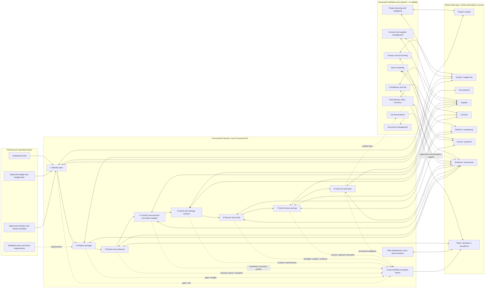
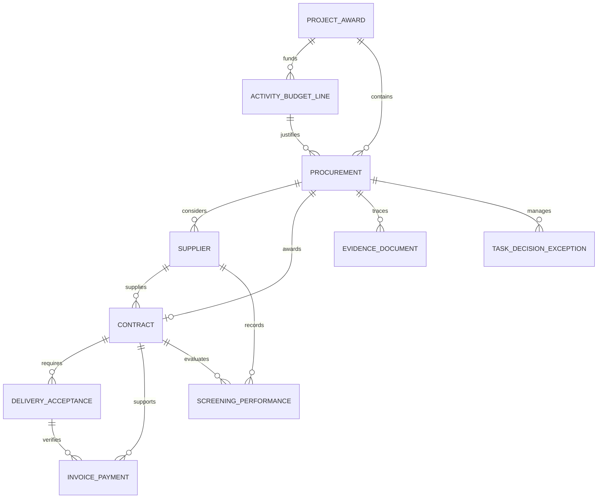
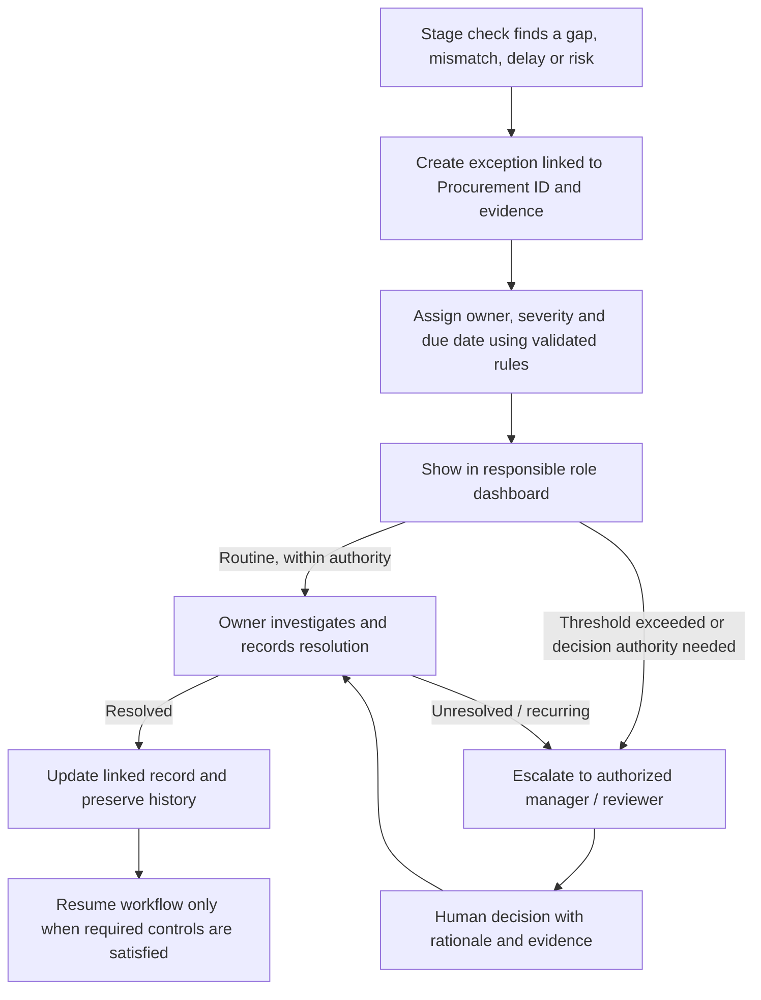

# ROP AI-Native Procurement Workflow

## End-to-end system map for planning and prototyping

**Basis:** Draft 0.2 | For CEO review | October 27, 2026  
**Status:** Target-state design. The current process, controls, authoritative systems and integrations have not yet been validated.  
**Purpose:** Lay out the full procurement harness as a practical workflow and data-flow map that can be transferred to butcher paper and used to shape a prototype.

> **Reading the map**  
> **Target state** describes the intended ROP workflow. **Validate** marks a policy, current practice, data source or integration that must be confirmed. **Proposed first slice** is a recommendation for prototyping, not an approved policy or confirmed implementation decision.

## 1. The system at a glance

The harness is an end-to-end, exception-driven workflow around a shared set of linked records. A procurement starts from a planned or unplanned need, moves through preparation, authorization, supplier selection, contract, delivery, invoice and payment, then closes with a complete evidence trail and learning. Role dashboards expose tasks and decisions; AI prepares and interprets information; conventional automation handles predictable routing and checks; people retain decision authority.

**How to read the shared layer:** stages create or update records; they do not create parallel copies of the same facts. Each fact should have one authoritative source, with linked references and an auditable history. The exact source application for each record is **Open / validate**. A changed delivery forecast can update forecasts and alerts, but must not silently change a signed contract or erase prior values.

## 2. Lifecycle swimlane: work, data, control and handoff

| Stage and trigger | Work and data created or updated | AI and automation | Human authority / handoff | Output and exception paths |
|---|---|---|---|---|
| **1. Identify the need**. Approved workplan, budget or activity schedule indicates a purchase; staff may also submit an unplanned need. | Read proposed item, quantity, budget line, project/activity, location and required date; check for duplicates; create a draft Procurement record with unique Procurement ID; calculate preliminary milestones. Link Project/Award and Activity/Budget Line. | **AI:** extract planned needs, classify category, flag ambiguity. **Automation:** create record, assign confirmation task, calculate milestones and remind. | Technical requester confirms or corrects need, quantities, specifications and delivery date. Handoff: confirmed need to package preparation. | Confirmed procurement need linked to project, activity, budget and intended result. **Exceptions:** no approved budget, unclear specifications, duplicate, unrealistic date. **Connections:** planning, budgeting, future project management workflow. |
| **2. Prepare the procurement package**. Need confirmed. | Determine proposed method and requirements; check remaining budget and quantity limits; draft specifications or Terms of Reference, market assessment and expected-cost benchmark; define documents, approvals, criteria and screening/diversification requirements; assemble requisition/package. | **AI:** draft specs, extract records, summarize costs, tailor checklist. **Automation:** populate forms, budget checks, choose templates, flag missing information. | Technical staff validate specifications. Procurement staff validate method and completeness. Authorized personnel decide budget revisions or exceptions. Handoff: complete draft package to review. | Draft package ready for review. **Exceptions:** missing specs, insufficient budget, weak benchmark, conflicting requirements. **Connections:** finance/accounting, compliance, planning, document management. |
| **3. Review and authorize**. Package complete. | Check completeness and consistency; verify method, competition requirements and pre-established criteria; route to authorized reviewers; retain approval/rejection/change requests; lock approved version and record applicable policy/donor requirements. | **AI:** identify gaps, contradictions and risks; draft evidence-based approval summary. **Automation:** route, remind, and block progression while mandatory controls are incomplete. | Authorized reviewers approve, reject, request changes or resolve exceptions within their authority. Handoff: authorized version to launch. | Authorized procurement package with version, policy basis, decision and evidence. **Exceptions:** missing controls or approval, inconsistent package, out-of-authority decision. **Connections:** approval authority, compliance, management dashboards. |
| **4. Conduct procurement and select supplier**. Authorized to launch. | Generate and issue solicitation; record issue and receipt dates; file bids/correspondence under Procurement ID; screen eligibility/sanctions; collect conflict-of-interest and confidentiality declarations; evaluate against criteria fixed before solicitation; prepare comparison matrix and recommendation. | **AI:** draft solicitation, extract bid information, compare evidence against criteria, identify inconsistencies. **Automation:** track deadlines, timestamp bids, route evaluation, flag overdue work. | People review every screening result before progression; resolve potential/ambiguous matches with documented rationale; evaluate evidence, resolve ambiguity and approve supplier selection. Handoff: approved award to contract. | Documented award supported by bids, evaluation, screening and approvals. **Exceptions:** no responsive bids, potential match, conflicts, suspected collusion, deviation from approved criteria. **Connections:** compliance, supplier management, document storage, donor reporting. |
| **5. Award and manage contract**. Supplier selection approved. | Draft contract/purchase order; compare with solicitation, winning bid, budget and requirements; route review and signature; record value, currency, deliverables, milestones, payment terms and withholding requirements; create obligation tasks; track amendments, performance and outstanding obligations. | **AI:** draft contract, extract obligations, identify discrepancies. **Automation:** populate fields, schedule milestones, notify affected teams. | People review/sign, approve amendments and resolve disputes. Handoff: executed terms and milestones to delivery, finance and field teams. | Executed contract/PO linked to obligations and milestones. **Exceptions:** discrepancies, unsigned contract, amendment, performance issue, dispute. **Connections:** contract management, finance, project scheduling, supplier performance. |
| **6. Receive and verify goods or services**. Delivery/service milestone due or reported complete. | Notify technical team and recipient; compare quantity, quality and conformity against contract; record dates, quantities and locations; capture goods received note/service acceptance; beneficiary signatures where required; photos/evidence when required and practical; shortages/damage/incomplete work; update inventory/assets if applicable. | **AI:** extract delivery information, compare against terms, flag discrepancies. **Automation:** reminders, discrepancy routing, delivery-status updates. | People inspect and accept, verify evidence and resolve discrepancies. Offline capture and later sync are **Open / validate**. Handoff: verified acceptance to invoice matching and closeout. | Verified delivery/service acceptance linked to contract. **Exceptions:** missing delivery, short quantity, poor quality, missing evidence. **Connections:** finance/accounting, field delivery, MEL, inventory, document management. |
| **7. Verify invoices and make payment**. Invoice/payment claim received. | Capture invoice once and link to Procurement ID and contract; match to contract and verified acceptance; check amount, quantity, price, currency, installment and remaining value; apply tax, withholding, payee verification and donor controls; flag mismatch, duplicate, unsupported charges; route; record payment reference/date/amount; reconcile balance. | **AI:** extract invoice data, explain discrepancies, draft payment summary. **Automation:** populate finance records, matching/duplicate checks, route approvals, update status after finance confirms transaction. | People resolve disputed charges, authorize payment and release funds through established controls. Handoff: reconciled payment to closeout. | Reconciled payment linked to procurement, contract, invoice and delivery evidence. **Exceptions:** mismatch, duplicate, unsupported charge, delayed payment, incomplete receipt. **Connections:** finance/accounting, bank reconciliation, compliance, reporting, audit. |
| **8. Close out and learn**. Obligations complete or authorized closeout decision. | Confirm all deliveries/acceptances; reconcile invoices, payments, credits and balances; check required documents and approvals; record supplier performance, claims and warranties; asset handoffs; create closeout checklist/evidence package; preserve history; feed reporting, management review and future planning. | **AI:** identify missing documents, draft closeout summary, analyze cost/time/performance. **Automation:** assemble package, update status, notify connected teams. | People confirm completion, approve closeout and validate lessons. | Complete traceable procurement record and reusable evidence. **Exceptions:** outstanding obligations, claims, missing records or unreconciled balances. **Connections:** reporting, management review, future procurement planning. |

## 3. Shared data architecture and record relationships

The **Procurement ID** is the workflow anchor. Documents, tasks, decisions and related records refer to it, while retaining their own identifiers and source references. “Enter data once” means capture at its authoritative point and reuse through links or controlled synchronization; it does not mean every application is replaced by one database.

| Core record | Key information from Draft 0.2 | Relationships and flow |
|---|---|---|
| **Project and award** | Project ID, donor, agreement, obligations, project period | Parent context for activities/procurements; provides applicable donor obligations. |
| **Activity and budget line** | Approved purpose, allocation, quantities, remaining balance | Need links to the purpose and funding; finance updates budget status and approved revisions. |
| **Procurement** | Procurement ID, method, status, responsible staff, milestones | Lifecycle anchor linking need, package, decisions, supplier, contract, receipt, invoice, evidence and closeout. |
| **Supplier** | Identity, eligibility, screening, performance | Linked to screening, bids, award, contract and performance records. Screening outcome always has human review before progression. |
| **Contract** | Executed terms, value, deliverables, dates, amendments | Defines obligations used for delivery verification and invoice matching. Signed terms are never silently overwritten. |
| **Delivery and acceptance** | Actual quantities, dates, locations, recipients, evidence | Confirms what was received; feeds field/MEL and inventory as applicable and supports invoice match. |
| **Invoice and payment** | Invoice ID, amount, approvals, transaction reference, reconciliation | Linked to procurement, contract, acceptance and finance transaction. Payment status returns from finance source when confirmed. |
| **Evidence and documents** | Source, type, date, version, linked records | Reusable references to requisition, approvals, bids, screening, contract, receipt, invoice and closeout evidence. |
| **Tasks, decisions and exceptions** | Owner, deadline, status, rationale, escalation history | Drives dashboards, reminders and management by exception; preserves who decided what and why. |

**Change behavior:** Changes to a delivery date may update forecast and alert affected staff; preserve prior value, source, timestamp and actor. They do not silently change signed contractual terms. Conflicting source records require an assigned owner and resolution history. The conflict-resolution model and authoritative source for each entity are open questions.

## 4. Cross-workflow data flows

All connections below are **proposed target-state integrations**, not verified current capabilities.

| Connected workflow | Procurement sends | Procurement receives | What this enables |
|---|---|---|---|
| Project planning and budgeting | Need, activity, budget line, delivery forecast | Approved changes and revised priorities | Planned needs can be proposed early; revised plans update forecasts and task priorities. |
| Finance and accounting | Requisition, contract, invoice, receipt evidence, payment request | Budget status, payment status, transaction reference | Budget checks and payment reconciliation without repeated entry. |
| Compliance and risk | Applicable rules, screening records, approvals, exceptions | Clearance, findings, corrective actions | Evidence-based controls and documented resolution. |
| Contract and supplier management | Award, obligations, milestones | Amendments, performance records, outstanding obligations | Contract lifecycle and supplier history stay connected to procurement. |
| Field delivery and MEL | Planned inputs, quantities, dates, locations | Verified delivery, beneficiary receipt, outcome evidence | Compare planned versus delivered inputs and connect receipt to activity evidence. |
| Communications | Verified procurement and delivery facts | Approved communication outputs | Communications can use facts verified through the workflow. |
| Donor reporting | Eligible expenditure, activities, evidence | Reporting requirements and submission status | Reporting reuses supported records and tracks reporting obligations. |
| Document management | Documents, versions, evidence links | Persistent storage references and retrieval status | Procurement record points to controlled evidence storage. |

## 5. Roles, dashboards and task movement

Dashboards are role-specific views over the same underlying tasks, decisions and procurement records—not separate data silos.

| Role | Default work view | Typical task handoffs |
|---|---|---|
| **Technical requester** | Upcoming needs, specifications to complete, delivery verification, technical blockers | Confirms need → validates specifications → verifies delivery/service. |
| **Procurement team** | Packages to prepare/launch, missing documents/approvals, evaluations/contracts in progress, screening review queue | Prepares package → routes review → conducts sourcing → documents recommendation → prepares contract. |
| **Finance team** | Invoices awaiting match, payment approvals, discrepancies/overdue payments, reconciliation tasks | Checks budget → matches invoice → routes payment → returns confirmed transaction reference/status. |
| **Management** | At-risk delivery dates, overdue decisions, material exceptions, budget/compliance concerns, assigned actions | Resolves or assigns issues above agreed thresholds; reviews status and evidence. |

Reminder logic should follow dependencies and deadlines, increase urgency when tasks slip, escalate only at agreed thresholds, and stop after completion. Channels, timing and escalation thresholds are **Open / validate**.

## 6. AI, automation and human authority

| Use | Appropriate work in target state | Boundary |
|---|---|---|
| **Conventional automation** | Deadline and lead-time calculations; required-field checks; approval routing; budget/threshold calculations; document linking; status updates; invoice matching; reminders and reports. | Apply explicit, validated rules. Do not infer policy where rules are unresolved. Preserve history and source. |
| **AI** | Extract/classify documents; draft specifications, solicitations, contracts and summaries; explain inconsistencies; compare bid evidence with approved criteria; identify missing evidence/unusual patterns; summarize performance and suggest improvements. | AI findings cite source material and remain distinguishable from verified facts. AI prepares and flags; it does not approve or resolve. |
| **People** | Approvals and exceptions; supplier selection/award; review and resolution of every screening result; contract signatures and amendments; delivery acceptance; payment authorization/release; closeout approval. | Decision rights, thresholds and required documentation must be validated. |

**Mandatory control:** Every supplier-screening result is reviewed by a person before the workflow proceeds. Potential matches or ambiguous results require documented resolution. This is explicit in Draft 0.2 and belongs in the prototype’s control model.

## 7. Exception handling: one queue across all stages

Each exception should be a structured record with **owner, severity, deadline, evidence, current status, decision/rationale and resolution history**. The queue is visible in role dashboards. Routine matters stay with the responsible team; matters requiring authority or exceeding agreed thresholds go to management. Thresholds are not yet defined.

Examples include a likely missed delivery date; quantities above approved budget; missing approval; possible supplier screening match; invoice/contract/receipt mismatch; delayed payment; repeated package corrections; no responsive bids; conflict of interest; quality or quantity discrepancy; missing closeout evidence.

## 8. Status conventions for process validation

Validate the proposed workflow against representative procurement records. Mark **each step and control** as one of:

| Status | Meaning | Evidence to capture |
|---|---|---|
| **Confirmed** | This accurately describes the current process or applicable requirement. | Source document, system record, policy reference or named process owner and date. |
| **Corrected** | The draft was inaccurate or incomplete and has been revised. | Corrected step plus source/owner and date. |
| **Not performed** | The activity/control is not part of current practice. | Who confirmed and whether target state should introduce it. |
| **Open question** | Process, authority, rule, system source or feasibility is unknown. | Owner and next action needed to resolve it. |

These labels describe validation status; they do not imply approval of a new policy. Keep a decision log for confirmed rules and a separate assumptions/open-questions list.

## 9. Target-state design vs current-state validation vs first build

| Layer | What is known | What must not be assumed |
|---|---|---|
| **Target-state design** | Draft 0.2 specifies eight stages, shared data architecture, connected workflows, role dashboards, AI/automation/human boundaries, exception handling, validation questions, success measures and an incremental implementation sequence. | That every step is current practice, that roles or thresholds are approved, or that every integration exists. |
| **Current processes and constraints** | The attachment does not document validated existing process maps, systems, authoritative data sources, policy versions, thresholds, offline conditions or integration feasibility. | Do not describe proposed connections or controls as existing facts. Validate against records and process owners. |
| **Proposed first build slice** | A useful initial prototype can test the shared record and a representative control-heavy path. Recommendation below. | The slice is not selected in Draft 0.2, is not a policy choice, and should not lock in unvalidated thresholds or a technology stack. |

### Proposed first build slice: one procurement from confirmed need through accepted delivery

Prototype one representative **planned procurement** with linked project/activity/budget context. Demonstrate: create Procurement ID; confirm need; prepare a minimum package; route review/approval as configurable placeholders; record a supplier and screening result with mandatory human review; record award/contract milestones; capture receipt/acceptance and an exception; show role tasks and evidence links; retain a timeline/audit history.

**Why this slice:** It tests the central data model and handoffs across planning, procurement, approval, supplier screening, contract and field receipt. It exercises the distinctive human control on screening and the downstream delivery evidence used by finance, while avoiding a claim that finance integration is ready. Invoice matching/payment can be the next extension after authoritative finance data and matching controls are validated.

**Prototype boundary:** This is a workflow and data-flow demonstration, not live purchasing, supplier clearance, contract execution or payment. Use representative records and configurable placeholders for rules that have not been confirmed. No technical stack is selected here.

## 10. Validation questions that can change the design

Resolve questions that affect data model, controls or sequencing before committing the build. Remaining questions can stay visible in the backlog.

| Area | Questions to validate |
|---|---|
| **Procurement rules and governance** | Definitive approval roles/thresholds by method/value band? Which policy version and donor rules apply by project? Authoritative screening sources, screening frequency and match-resolution owner? Diversification/concentration controls? Mandatory documents, signatures and approvals by stage? |
| **Planning and scheduling** | Which delivery date drives schedule: activity date, contract date or separately confirmed date? Source and owner of lead-time estimates? Handling urgent/unplanned needs and workplan changes? How much preparation may precede formal authorization? |
| **Data and systems** | Authoritative source for project, budget, supplier, contract, invoice and payment? Which systems connect first and are technically feasible? Conflict resolution and data correction owner? Permissions for sensitive information? Retention and version history requirements? |
| **Digital field operations** | Field devices/apps for signatures, quantities, locations and photos? Connectivity and offline sync needs? How to verify beneficiary identity without unnecessary personal data? Evidence requirements by goods, service and distribution type? |
| **Finance and closeout** | Exact matching and approval rules, including partial deliveries/installments? Withholding and country-specific rules? How does payment status return from finance? Formal closeout conditions and approver? |
| **User experience and management** | Default tasks by role and management escalation criteria? Reminder channels/frequency? Acceptable AI autonomy for drafting/checks and which outputs need human review? Portfolio performance measures? |

## 11. Success measures and baseline plan

Set baselines before targets. Compare a representative sample of procurements using consistent start/end definitions and record differences by procurement type where needed.

| Measure | What it tells us | Baseline definition to agree |
|---|---|---|
| Time from identifying need to procurement start | Whether planning leads to earlier action | Define “need identified” and “procurement start”; measure elapsed time. |
| Started early enough to meet delivery date | Forecast and lead-time usefulness | Agree required date source and what counts as on time. |
| End-to-end cycle time | Overall workflow speed | Define start/end and handle paused/exception time transparently. |
| Incomplete submissions and review rounds | Package quality and rework | Count returns and correction cycles by cause. |
| Staff time per procurement | Administrative burden | Sample active staff time, not just elapsed calendar time. |
| Complete traceable evidence | Control and audit readiness | Define required evidence set by procurement type. |
| Invoice-matching errors and payment delays | Finance handoff quality | Define mismatch categories and payment-delay clock. |
| Exceptions identified before approval | Preventive control effectiveness | Track stage detected, severity and eventual outcome. |
| AI extraction accuracy, false flags and missed exceptions | AI performance and review burden | Establish a labeled sample and human adjudication. |
| Staff satisfaction and digital field usability | Adoption and practical fit | Collect feedback by role and field context. |

Objective: reduce administrative burden while improving control and delivery performance. Avoid optimizing speed alone if it degrades evidence quality or control.

## 12. Recommended next steps

1. **Map two or three representative procurement records** against the eight stages. Mark every step Confirmed, Corrected, Not performed or Open question, and capture the source.
2. **Resolve the data/control decisions that affect the prototype:** Procurement ID and authoritative record sources; approval and screening handoffs; required receipt evidence; who owns exceptions. Keep unresolved thresholds configurable.
3. **Sketch the proposed first slice on butcher paper** using three swimlanes—People, Workflow/automation, Shared records—and place exception cards beneath the stage where they arise. Then test the sketch with the people who perform the work.
4. **Only after that review, specify the prototype**: representative scenario, fields, statuses, permissions, audit events, integrations in scope, and what remains simulated.
5. **Capture baseline measures** from the same representative records before judging whether the prototype improves the workflow.

The full lifecycle remains the design target even if the first prototype covers only a coherent slice.
