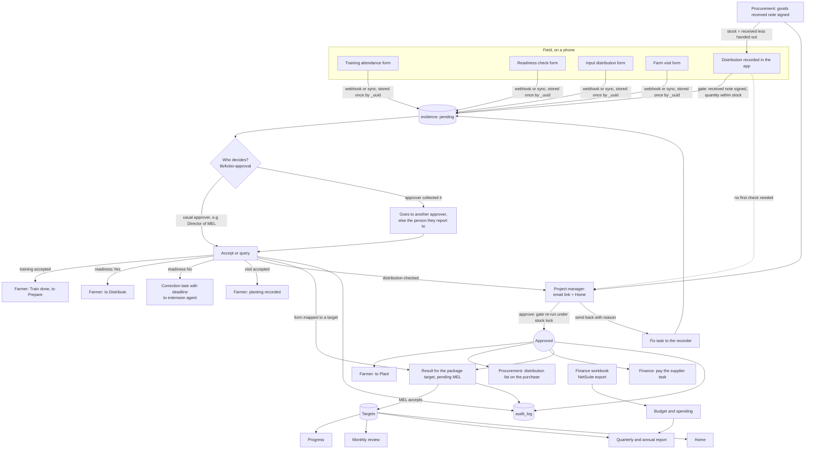

# 01. Map of the ROP Workflow app

Written 16 Nov 2026 from `main` at `79b4f5a`. Read from the code and checked by running the app against a throwaway local Postgres with the fictional A-2027 data (`npm run db:seed`, `DEMO_SIGN_IN=1`). Nothing here touched Supabase.

**How to read "checked":** *run* means I called the API or opened the screen as that role. *read* means I read the code only.

## 1. The shape in one paragraph

A Next.js app (React, TypeScript) on Postgres. Rules with no database live in `src/lib`, database and AI code in `src/server`, routes in `src/app/api` (all behind `src/server/guard.ts` / `requireViewer`), screens in `src/components`. Field data arrives from KoboToolbox as rows in one table, `evidence`, and waits there as `pending` until a named person accepts it. Each farmer's place in the season is one JSON document in `field_items`. Per-project settings (input package, who approves KoboCollect data, distribution checks) are JSON documents in `project_state`. Money comes in from Finance's workbook (NetSuite or QuickBooks export). HR is an append-only ledger.

## 2. Workflow areas and their screens

| Area | Screens (address) | Main rules | Main storage |
|---|---|---|---|
| **Project design** | New project and setup wizard `/setup` (8 design steps, 4 plan steps, 4 KoboToolbox steps), three-uploads setup (agreement, logframe, budget), design `/design`, lens review `/setup/lens`, target details `/progress/targets`, framework `/progress/framework`, opportunities `/work/opportunities`, grants `/work/grants`, portfolio `/portfolio` | `lib/project-setup.ts`, `server/setup-extract.ts`, `lib/market-windows.ts`, `lib/target-details.ts` | `projects`, `indicators`, `donors`, `budget_lines`, `workplan_items` |
| **Field activities** | Field activities (under Record, `/work?source=field`), farmer profile `/field/farmers/[id]`, approval page `/approve/[code]/[id]`, results and proof `/progress/results` (holds the review queue for field forms), field records `/progress/records`, photos, stories, weekly update | `lib/field.ts` (steps and checks), `lib/distribution.ts` (gate and flags), `lib/kobo-approval.ts` (who decides), `lib/package.ts` | `evidence`, `field_items`, `project_state` (`field-setup`, `distributions`, `kobo-approval`, `stock`), `farmers`, `farmer_pii` |
| **Finance and accounting** | Budget and spending `/progress/budget`, procurement calendar `/work/plan`, purchases `/work/procurements`, bills `/work/bills`, suppliers `/work/suppliers`, monthly close `/work/closeout`, FACE form `/progress/face`, expenses `/expenses`, payroll `/payroll` | `lib/procurement.ts`, `lib/bva.ts`, `lib/spend-map.ts`, `lib/bills.ts`, `lib/policy.ts` | `procurements`, `procurement_plan`, `budget_lines`, `project_state` (`actuals`, bills) |
| **HR** | People `/people`, my record `/people/me`, leave, timesheets, expenses, payroll, onboarding, offboarding, people admin `/settings/people` | `lib/hr.ts`, `lib/leave.ts`, `lib/timesheet.ts`, `lib/payroll.ts` | `hr_ledger`, `hr_files`, `staff` |
| **Reporting (reads the others)** | Progress `/progress`, monthly review `/progress/review`, pre-flight `/progress/preflight`, quarterly `/progress/report`, annual `/progress/annual`, donor share link `/share/[code]/[token]` | `lib/qpr.ts`, `lib/preflight.ts`, `lib/evidence.ts` | reads `evidence`, `indicators`, `budget_lines` |
| **Across all** | Home `/home`, Tasks `/work`, Organization `/organization`, Settings, audit `/progress/audit` | `lib/home-buckets.ts`, `server/home-store.ts` | `work_items`, `audit_log` |

48 screens in total under `src/app/(app)`, plus sign-in, About, the approval page and the donor share page.

## 3. Roles

The app has no single "role" field. A person (`staff.profile`) carries four lists, and the brief's roles map onto them like this:

| Role in the brief | In the app | What they can do |
|---|---|---|
| Field officer | `field: ["extension"]` or `["store"]`, `fieldAccess: "edit"` | Move a farmer through the steps they own, record results with proof, record a distribution (storekeeper), fix one sent back |
| MEL officer | `field: ["mel"]`, `project: ["mel-owner"]` | Accept or query results and field forms, own the readiness step, write reports |
| Director of MEL | No fixed role. The project names one person under "Who approves KoboCollect data" (`project_state` `kobo-approval`, `who: "named"`) with a stand-in | Only they (or the stand-in) can accept anything that came from KoboCollect on that project |
| Approver (project manager) | `field: ["manager"]` | Approves or sends back each input distribution, decides removals |
| Finance | `procurement: ["finance"]`, `project: ["finance-import"]` | Imports spending, gets the "pay the supplier" task, vouchers |
| HR | Roles held in the HR ledger (`lib/authority.ts`), not on the person | HR record, payroll, leave approvals |
| Admin | `admin: true` | People, settings, "View as" (read-only) |
| Also | Plan approver, monthly review, report release, comms, procurement officer, committee, Home Office review, donor (read-only) | |

Reporting lines are `reportsTo` on each person. They are used in one rule: when the only person who could approve a record is the one who collected it, the record goes to the person they report to (`lib/kobo-approval.ts`, `decidersOf`).

## 4. The priority workflow: farm input distribution (run)

1. **Before anything goes out.** The project manager saves the input package once (Field activities setup): each item, its amount per farmer or per hectare and the budget line it is bought on. Purchases on that line supply the store.
2. **Goods received.** The requester signs the goods received note on the purchase (`receive` step). Store stock is that figure less what has been handed out. Nobody types stock.
3. **Field form.** The storekeeper records the distribution in the app (farmer at Distribute, tick "recipient confirmed by signature or thumbprint", tick voucher) or sends the KoboCollect distribution form. The gate (`lib/distribution.ts`, `gate`) refuses it when a goods received note is not signed or the quantity is more than was received.
4. **Check of KoboCollect data.** A KoboCollect record first goes to whoever the project names for KoboCollect data, never its own collector. No email goes to the manager until that check is made.
5. **Instant notification.** The project manager is emailed a single-use link (one per manager) and sees "Approve the input distribution to F-0002" as the next step on Home.
6. **Approval.** Approve re-runs the gate under a stock lock, then in one transaction: the farmer moves to Plant, the purchase's distribution list grows, Finance gets a "pay the supplier" task when a payment is still due, one result is made for the target the package names (waiting for MEL), and the audit log has it. Send back needs a reason and makes a fix task for the recorder, who corrects and resends on the same page.

## 5. Every handoff between workflows

| # | From | To | What crosses | Trigger | Checked |
|---|---|---|---|---|---|
| 1 | Project design (budget) | Finance (procurement calendar) | Budget lines marked "procure" become planned purchases | Build calendar from budget | read |
| 2 | Project design (budget) | Field (input package) | Each package item names a budget line | Manager saves the package | run |
| 3 | Project design (targets) | Field and reporting | The package names the target a distribution counts toward; forms are mapped to targets | Setup | run |
| 4 | Finance (goods received note) | Field (store stock, gate) | Received quantity per budget line | Requester signs the received note | run |
| 5 | KoboToolbox | Review queue | Submission stored once by `_uuid`, pending | Webhook or sync | read |
| 6 | Review queue (readiness) | Field | Farmer moves to Distribute or Correct; a correction task with a deadline | Approver accepts | read |
| 7 | Review queue (training, visit) | Field | Train ticks and move to Prepare; planting recorded | Approver accepts | read |
| 8 | Field (distribution) | Approver | Email link plus Home row | Record saved | run |
| 9 | Approved distribution | Finance | Purchase's distribution list; "pay supplier" task | Approval | run |
| 10 | Approved distribution | Reporting | One result for the named target, pending MEL | Approval | run |
| 11 | Accepted results | Progress, Home, monthly review, quarterly, annual | One counting function for every screen | On read | read |
| 12 | Finance workbook | Budget, Home, report | Spending by budget line | Finance imports | read |
| 13 | HR (staff list) | Every approval | Who holds a role, who they report to, their email | Read at decision time | run |
| 14 | BambooHR | HR record | Import of people (`lib/bamboo-import.ts`) | HR imports a file | read |
| 15 | SharePoint | Procurement pre-check, Resources | Links only; no data is copied | By hand | read |

## 6. How data flows from Kobo through approval into each workflow

## 7. External systems

| System | How the app meets it today |
|---|---|
| KoboToolbox | Per-project API token (encrypted), forms linked in setup, webhook per project with its own password, nightly reconcile. Farmer list pushed to forms as `farmers.csv` (IDs, village, initials; no names). |
| NetSuite | No live link. Finance exports a workbook; the app imports it and maps lines to the budget. |
| BambooHR | No live link. File import into the HR record. |
| SharePoint | Links from Resources and from procurement. Nothing is synced. |
| Email | Resend (`RESEND_API_KEY`). Without it nothing is emailed and the app says so on the record. |

## 8. Tables that exist but are not the source of truth

The first schema has relational tables for the season (`activities`, `training_attendance`, `readiness_checks`, `corrections`, `input_distributions`, `field_visits`, `mel_findings`, `management_actions`, `expenditures`). Today only `readiness_checks` and `corrections` are written (when a readiness form is accepted). Training, visits and distributions live in `evidence` (the raw form) and in the farmer's JSON document. The audit (02) covers what this costs for analysis.
